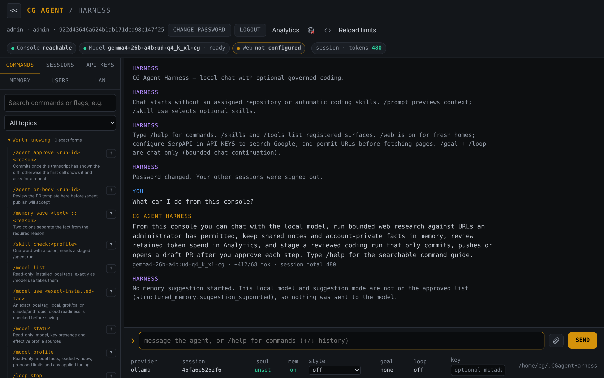

# CG Agent Harness

[](https://github.com/cgfixit/CG-agent-harness/actions/workflows/ci.yml)
[](https://github.com/cgfixit/CG-agent-harness/actions/workflows/bundle.yml)

**A private research desk on your own machine.** CG Agent Harness is one loopback-only Rust service for long-form research with a local model: page reads fenced by URL rules you write, citations and quotes checked against fetched passages, jobs that outlive the tab, and goal loops, memory, and Markdown export for work spanning many turns. Cloud models, repository writes, external tools, and LAN observation ship off; CI tests, not prose, enforce the boundaries.

Built for researchers and security-minded operators who expect an audit trail and least privilege from any local process.

[](docs/screenshots/console-chat-2026-10-30.png)

Fresh home, loopback fixture model, 2026-10-30. [Silent 60-second demo](docs/screenshots/demo/CG-Agent-Harness-60-second-demo.mp4) of a synthetic release review ([notes](docs/screenshots/demo/voiceover-cues.txt)).

[Quick start](#quick-start) · [Engineering choices](#engineering-choices) · [Security and defaults](#security-and-defaults) · [Documentation](#documentation)

## What you can do

| Capability | What it provides | Starting state |
|---|---|---|
| **Web research** | SerpAPI, Tavily, or public Google search; permitted fetches and crawls (opt-in Firecrawl fallback); `/web research` jobs with planned subqueries and checked quotes. | On in allowlist mode with one seeded rule, Google search; listings never authorize page reads; failed keyed searches fall back to public Google. |
| **Goal loops** | `/goal` and `/loop` continue a long piece as a run outliving the browser, under turn, token and failure limits. | Fresh defaults: 50 turns, 200,000 tokens, two failed turns. [Unlimited homes warn](docs/CONSOLE.md#71-sessions-and-bounded-chat-continuation); cloud refuses loops. |
| **Memory** | Shared pinned notes plus account-private facts you select per session, recall, and proposed summaries that carry findings between sessions. | Capture, recall, and retrieval on; applying a proposal needs review ([setup](docs/INSTALL.md#memory-setup)). |
| **Local chat** | Streaming sessions with owner-scoped transcript search and per-session Markdown export in the Sessions pane, text and DOCX attachments, prompt skills, nine session style presets, `/prompt` inspection, and a sandboxed HTML preview. | Ollama on loopback by default; listed, pulled, and tuned from the console. No persona or style applies until you write `soul.md` or pick a preset. |
| **Analytics** | Session, token, and run history with USD where rates exist, plus **Estimate draft** before a cloud call. | On after sign-in; read-only; local inference unpriced. |
| **Cloud chat** | Optional Grok or Claude. Sends only the new message, never history, memory, skills, attachments, or web context. | Needs a provider key; refused for `/loop`. |
| **MCP integrations** | Declared external tools and a separate read-only memory gateway with dedicated machine credentials. | Both off. |
| **Reviewed coding** | Optional edits in isolated clones; sandboxed checks, diff review, separate Git approval. | Off until configured for a selected repository. |
| **LAN observation** | Netconnect reads in-scope interfaces, routes, and neighbors from local tables. | Off with empty scope; only the budgeted `diag` probe sends packets; no scans or device control. |
| **Self-knowledge and diagnostics** | Bundled harness manual and live status as untrusted local-chat context; `/diag` shows bounded, redacted tails of allowlisted home logs. | Manual on, never sent to cloud chat or loops; `/diag` on, admin or `portal_auditor` only. |

Fresh-home states; upgrades keep existing choices ([console guide](docs/CONSOLE.md#what-you-can-do)).

## How long-form research works

1. **Set the boundary.** `/web allow <pattern> --group <name>` grants a topic's sites; search listings never authorize page reads.
2. **Start a job.** `/web research --group <name> <question>` plans up to 3 subqueries over 2 rounds, crawls once, and ranks about 6,000 evidence tokens. `/web job` follows it after the tab closes; `/web cancel` stops it.
3. **Read a checked answer.** Support, conflicts, inference, and missing or stale evidence are labeled; a claim whose citation or quote fails is dropped.
4. **Build the long piece.** One answer is at most 2,048 tokens (`web.model_tokens`), so longer work spans runs: `/goal`, `/loop`, memory pins, then Markdown export.
5. **Fit your hardware.** Discovery and answering have separate deadlines (1,200 s and 1,800 s, up to an hour each); `auto_tune` sizes them.

Goal loops select relevant page passages and retain checked evidence references through compaction ([router design and measurements](docs/learning/web-decision-router.md)).

Rank is not truth, and bounded runs never claim completeness ([research](docs/SECURE_RESEARCH.md#fetch-discovery-and-research), [transcripts](docs/CONSOLE.md#search-and-export-session-transcripts); coding: [pipeline](docs/CODING_PIPELINE.md)).

## Engineering choices

| Decision | Purpose | Explore |
|---|---|---|
| Separate console and coding processes | Coding runs behind an allowlisted subprocess interface. | [Shim](src/shim/mod.rs), [invariant tests](tests/invariant_guard.rs) |
| Separate memory proposals from facts | Models suggest; canonical facts change only on approval. | [Memory guide](docs/MEMORY_GUIDE.md), [tests](tests/structured_memory.rs) |
| Contracts as tests | Isolation, shipped gates, routes, and doc size fail `cargo test`, not review. | [Invariants](INVARIANTS.md), [guard](tests/invariant_guard.rs) |

**Stack:** Rust, Tokio, Axum, SQLite, Tantivy, and Tauri for the macOS desktop shell.

## Quick start

A **home** is the application's state directory: `~/.CGagentHarness`, overridden with `CGAGENTHARNESS_HOME`. Run one app or standalone server per home.

**macOS, from scratch:** after `xcode-select --install`, `scripts/install-macos.sh` installs Rust, Ollama, and the release app as needed and builds the backend; `scripts/start-macos.sh` opens the app and console ([automated install](docs/INSTALL.md#1-quick-start-automated-macos-install), [browser access](docs/INSTALL.md#7-open-the-console-in-a-browser)).

### 1. Prepare a local model

Pick an installed model that fits your hardware; any OpenAI-compatible loopback service works, and chat and the coding planner have separate settings. The chat and planner default `qwen3.8:27b-mlx-cg` is a [locally derived tag](docs/MODELS.md#pin-32768-with-a-local-derived-tag), not bundled or required.

The default endpoint is `http://127.0.0.1:11434/v1`. Seeded research budgets assume a **32,768-token context window**; the harness sends no `num_ctx`, so set it before Ollama starts ([Models](docs/MODELS.md) covers Ollama.app, smaller windows and pinned tags):

```bash
OLLAMA_CONTEXT_LENGTH=32768 ollama serve
```

### 2. Choose how to run the harness

#### macOS app

Download `CG-Agent-Harness-macos-universal.zip` and `SHA256SUMS` from [Releases](https://github.com/cgfixit/CG-agent-harness/releases/latest), then run from the download directory:

```bash
shasum -a 256 -c SHA256SUMS
unzip CG-Agent-Harness-macos-universal.zip
open "CG Agent Harness.app"
```

The universal app needs no Rust, Python or browser and is ad-hoc signed ([Desktop](docs/DESKTOP.md) covers Gatekeeper); its Setup window exports the public certificate for [browser trust](docs/SECURE_RESEARCH.md#https-and-native-trust). Releases also attach Linux x86_64 and macOS arm64 CLI builds with `.sha256` files.

#### Standalone server: macOS or Linux

Source builds need **Rust 1.88** and a C toolchain; the macOS app build also needs 1.90 ([Install](docs/INSTALL.md), [app build](docs/INSTALL.md#52-macos-app)).

```bash
git clone https://github.com/cgfixit/CG-agent-harness.git
cd CG-agent-harness
cargo build --release --locked
./target/release/cgagentharness serve
```

Open `https://127.0.0.1:8790/` and trust the local certificate ([certificate guide](docs/SECURE_RESEARCH.md#https-and-native-trust)). Non-loopback binds are refused.

### 3. Sign in and try a conversation

1. Fresh homes open **Set your password**: enter the setup code (app: **Setup and recovery** stays open with it; terminal: `<home>/setup-code`) and a new password.
2. `/model list` shows installed tags; `/model use <tag>` selects one and tunes its limits ([profiles](docs/MODELS.md#exact-model-diagnostics-and-optional-fallback)).
3. Run `/status`, send a message, inspect the assembled context with `/prompt`, and browse `/help`.
4. Research: `/web allow https://example.org/*`, then `/web research <question>` ([research setup](docs/SECURE_RESEARCH.md#search-fetch-and-research)).

## Security and defaults

- **Local access:** fresh homes require HTTPS and account login; the optional harness API key never replaces them.
- **Web policy mode:** homes ship in allowlist mode; an administrator can confirm block-list mode, which opens every public URL no block rule covers; private addresses stay refused.
- **Network boundaries:** loopback binding limits incoming access only; research, cloud providers, subprocesses, and model runtimes still reach the network.
- **Cloud coding:** six gates end in per-run `--confirm-online`, and requests send repository excerpts before diff review; redaction does not remove proprietary code.
- **Sandbox differences:** macOS uses Seatbelt. Linux prefers bubblewrap; its `unshare --net` fallback isolates networking only.
- **Data scope:** structured memory and sessions are account-owned; other home state is [shared](SECURITY.md#local-authority-and-shared-resources), so this is not tenant isolation.
- **Credentials and records:** provider keys default to the OS credential store, with a startup warning while plaintext storage is on; audit records are redacted and stay in the home.

Windows has [focused PR checks and full `main` CI](docs/INSTALL.md#tests-and-cicd), with no release. Details: [Security](SECURITY.md), [Invariants](INVARIANTS.md), [Secure research](docs/SECURE_RESEARCH.md).

## Command line

Six public commands, each with `--help`: `serve` starts the console; `account` covers login, password, and logout; `web` manages URL rules, search, fetch, and research; `tls` inspects and renews the certificate; `mcp-key` manages memory-gateway keys; `netconnect` offers gate `status`, passive `devices`, and the budgeted `diag` probe.

## Configuration and verification

First launch seeds the home's `config.yaml` from [the defaults](assets/config.default.yaml); edit that copy. Gates need literal YAML `true`, malformed numbers stop startup, and startup logs any shipped-`true` setting your file lacks. Most settings need a restart; selected limits [reload live](docs/CONFIG_RELOAD.md).

Before contributing, run `bash scripts/ensure-githooks.sh` ([hook guide](docs/GITHOOKS.md)) and follow [AGENTS.md](AGENTS.md); `SKIP_LIVE=1 scripts/verify-local.sh` runs the broad checks and CI adds the rest ([Tests and CI/CD](docs/INSTALL.md#tests-and-cicd)).

**Identify builds by commit** (`Contents/Resources/COMMIT`), not the Cargo version; `main` can be newer than published binaries.

## Documentation

| Topic | Guide |
|---|---|
| Setup, models, upgrades, recovery | [Install](docs/INSTALL.md), [Models](docs/MODELS.md), [Troubleshooting](docs/TROUBLESHOOTING.md) |
| Chat, attachments, skills, connectors, commands | [Console](docs/CONSOLE.md) |
| Memory behavior and ownership | [Memory](docs/MEMORY_GUIDE.md), [Structured memory](docs/STRUCTURED_MEMORY.md) |
| Coding, jobs, schedules | [Coding pipeline](docs/CODING_PIPELINE.md) |
| External tools and private memory access | [MCP client](docs/MCP_CLIENT.md), [MCP server](docs/MCP_SERVER.md) |
| Passive LAN observation | [Netconnect](docs/netconnect.md) |
| Usage, costs, completion webhooks | [Analytics, spend and notifications](docs/SPEND_AND_NOTIFICATIONS.md) |
| Desktop app, Gatekeeper, reset | [Desktop](docs/DESKTOP.md) |
| Web boundaries and certificates | [Secure research](docs/SECURE_RESEARCH.md), [Security](SECURITY.md) |
| API, dependencies, releases | [Routes](docs/API_ROUTES.md), [Dependencies](docs/DEPENDENCIES.md), [Releasing](docs/RELEASING.md) |

## License

[MIT](LICENSE).
