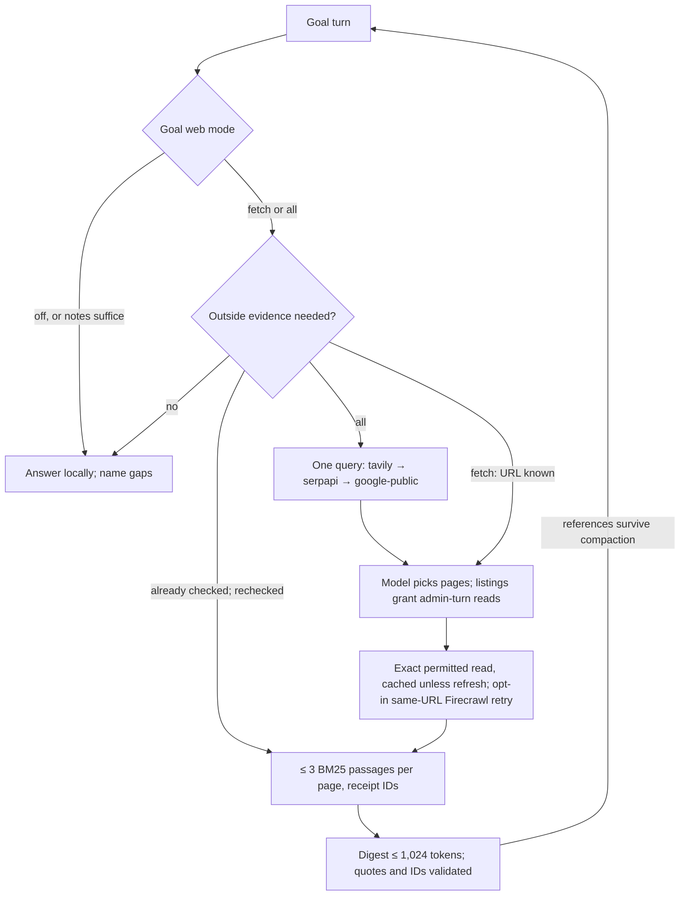

# CG Agent Harness

[](https://github.com/cgfixit/CG-agent-harness/actions/workflows/ci.yml)
[](https://github.com/cgfixit/CG-agent-harness/actions/workflows/bundle.yml)

**An affordable, secure research agent loop on your own machine.** One loopback-only Rust service researches with a local model; cloud calls are optional and capped, and every read obeys your URL rules.

[](docs/screenshots/console-chat-2026-10-30.png)

[60-second demo](docs/screenshots/demo/CG-Agent-Harness-60-second-demo.mp4)

## What you can do

| Capability | What it provides | Fresh home |
|---|---|---|
| **Web research** | Search, permitted reads and crawls, `/web research` with checked quotes, PDF text, [evaluation capture](docs/SECURE_RESEARCH.md#chat-capture-for-offline-evaluation); paid providers have daily caps. | On; one seeded Google rule. |
| **Goal loops** | `/goal` and `/loop` outlive the tab; a counted run ends on its best answer. | 200 turns, 200,000 tokens, two failures; local only. |
| **Memory** | Pinned and [uploaded notes](docs/CONSOLE.md#text-file-attachments-and-prompt-preview), account-private facts. | On; proposals need review. |
| **Local chat** | Sessions, search, export, DOCX/PDF/text attachments, skills, styles; no Ollama cloud models (tags or aliases). | Ollama on loopback. |
| **Browser tasks** | `/browse <site> <task>` drives sandboxed Chrome on named sites only, never types passwords, and sends an approved held non-GET/HEAD request once. | On for administrators. |
| **Accounts, diagnostics** | Administrator, operator and auditor roles, eight sessions per account; token and run history, **Estimate draft**, redacted `/diag` logs. | On; `/diag` admin or auditor. |
| **Cloud chat** | Optional Grok or Claude; only the new message leaves, redacted. | Needs a key. |
| **Off by default** | Reviewed coding in isolated clones (local or cloud planner), MCP tools and gateway, Netconnect, Firecrawl, webhooks; native computer use is a closed gate ([#996](https://github.com/cgfixit/CG-agent-harness/issues/996)). | Configure each. |

## The research loop

Code owns permission, budgets and deadlines; the model picks searches, pages and conclusions.



`all` is the default. The digest proves provenance, not support; `GOAL_DONE` is model advice ([#772](https://github.com/cgfixit/CG-agent-harness/issues/772)).

## Design invariants

Contracts: [INVARIANTS.md](INVARIANTS.md), checked by [the guard](tests/invariant_guard.rs) and focused tests.

- **Loopback only.** Other binds are refused; fresh homes need HTTPS and login.
- **Process isolation (I6).** Coding runs only as an `agentic` child behind an allowlisted [shim](src/shim/mod.rs); browser children get no provider keys.
- **Gated writes.** Gates ship false; approve, push and publish need a reason and confirmation; review tags expose a changed redacted value; checks run under Seatbelt or bubblewrap.
- **Current permission.** Reads are DNS-pinned to public addresses; policy and sign-ins are rechecked after waits and before delivery. Replies render as text.
- **Strict config.** Gates need literal YAML `true`; malformed numbers stop startup.
- **No secrets out.** Keys live in the OS credential store, never in responses, logs or model context.
- **No telemetry.** Both `deny.toml` files ban telemetry crates, enforced in CI.

Accounts are not tenants ([shared state](SECURITY.md#local-authority-and-shared-resources)).

## Quick start

A **home** (`~/.CGagentHarness`, `CGAGENTHARNESS_HOME`) serves one app or server. **macOS from scratch:** `scripts/install-macos.sh`, then `scripts/start-macos.sh` ([guide](docs/INSTALL.md#1-quick-start-automated-macos-install)).

### 1. Local model

Any OpenAI-compatible loopback server works; the default `qwen3.8:27b-mlx-cg` is a [derived tag](docs/MODELS.md#pin-32768-with-a-local-derived-tag). Budgets assume a **32,768-token window**; no `num_ctx` is sent:

```bash
OLLAMA_CONTEXT_LENGTH=32768 ollama serve
```

### 2. Run it

**macOS app** ([ad-hoc signed](docs/DESKTOP.md)), from [Releases](https://github.com/cgfixit/CG-agent-harness/releases/latest):

```bash
shasum -a 256 -c SHA256SUMS
unzip CG-Agent-Harness-macos-universal.zip
open "CG Agent Harness.app"
```

**Server, macOS or Linux** (Rust 1.89, a C compiler; [Install](docs/INSTALL.md)):

```bash
git clone https://github.com/cgfixit/CG-agent-harness.git
cd CG-agent-harness
cargo build --release --locked
./target/release/cgagentharness serve
```

Open `https://127.0.0.1:8790/` and trust the [local certificate](docs/SECURE_RESEARCH.md#https-and-native-trust).

### 3. Sign in

1. **Set a password** (12+ characters) with the setup code from **Setup and recovery** or `<home>/setup-code`.
2. `/model list`, `/model use <tag>`, `/help`.
3. `/web allow https://example.org/*`, then `/web research <question>` or `/goal <question>` and `/loop 3`.
4. `/browse` needs Google Chrome and `PLAYWRIGHT_SKIP_BROWSER_DOWNLOAD=1 npm ci --ignore-scripts` in `browser/`: `/browse docs.python.org what does zipfile.Path do?`.

## Commands and docs

CLI (`--help` each): `serve`, `account`, `web`, `tls`, `mcp-key`, `netconnect`; console: [slash reference](docs/CONSOLE.md#78-slash-command-quick-reference). First launch seeds `config.yaml` from [the defaults](assets/config.default.yaml); edit, then restart or **Reload limits** ([reloadable](docs/INSTALL.md#reload-limits-without-a-restart)). [docs/README.md](docs/README.md) indexes the guides; contributors read [AGENTS.md](AGENTS.md). Windows has CI, not a release.

## License

[MIT](LICENSE).
