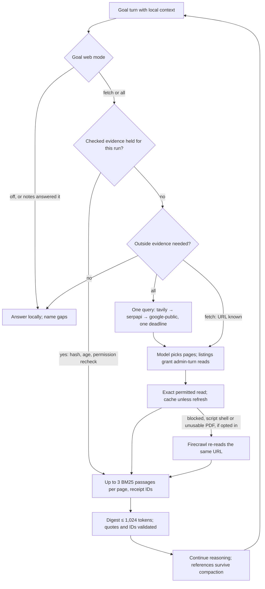

# CG Agent Harness

[](https://github.com/cgfixit/CG-agent-harness/actions/workflows/ci.yml)
[](https://github.com/cgfixit/CG-agent-harness/actions/workflows/bundle.yml)

**An affordable, secure research agent loop on your own machine.** One loopback-only Rust service researches with a local model: goal loops, evidence-checked web research, browser tasks on sites you name, and memory for the findings. Cloud calls are optional and priced first; every read obeys your URL rules.

[](docs/screenshots/console-chat-2026-10-30.png)

[60-second demo](docs/screenshots/demo/CG-Agent-Harness-60-second-demo.mp4) · [Quick start](#quick-start) · [Research loop](#how-the-research-loop-decides) · [Invariants](#design-invariants) · [Documentation](#documentation)

## What you can do

| Capability | What it provides | Fresh-home state |
|---|---|---|
| **Web research** | Search, permitted reads and crawls, `/web research` jobs with checked quotes, local PDF text. | On; allowlist with one seeded Google rule. |
| **Goal loops** | `/goal` and `/loop` continue after the tab closes. | 200 turns, 200,000 tokens, two failed turns; local only. |
| **Memory** | Pinned and [uploaded notes](docs/CONSOLE.md#text-file-attachments-and-prompt-preview), account-private facts. | On; proposals need review. |
| **Local chat** | Sessions, transcript search and export, text, DOCX and PDF attachments, skills, styles. | Ollama on loopback. |
| **Browser tasks** | `/browse <site> <task>`: the local model drives sandboxed Chrome on those sites only. Block rules cover every request and redirect; password fields and non-GET/HEAD requests are held. | On for administrators; [setup](#3-sign-in-and-research). |
| **Analytics, diagnostics** | Token and run history, **Estimate draft**, `/diag` redacted logs. | On; `/diag` admin or auditor. |
| **Cloud chat** | Optional Grok or Claude; only the new message leaves. | Needs a key. |
| **Off by default** | Reviewed coding in isolated clones, MCP tools and memory gateway, Netconnect LAN observation, Firecrawl fallback reads, completion webhooks. Native computer use: closed gate only ([#996](https://github.com/cgfixit/CG-agent-harness/issues/996)). | Each needs configuration. |

## How the research loop decides

Code decides permission, budget and deadlines; the model chooses searches, pages and conclusions.



`all` is the shipped goal web mode. The digest proves provenance, not logical support; `GOAL_DONE` stays model advice. Open: [#772](https://github.com/cgfixit/CG-agent-harness/issues/772).

## Design invariants

Contracts live in [INVARIANTS.md](INVARIANTS.md); the [guard](tests/invariant_guard.rs) fails `cargo test` when one breaks.

- **Loopback only.** Non-loopback binds are refused; fresh homes need HTTPS and login.
- **Process isolation (I6).** The coding pipeline runs only as a `cgagentharness agentic …` child behind an allowlisted [shim](src/shim/mod.rs); browser tasks run in a child with no provider keys.
- **Writes are gated.** Write gates ship false; approval, push and publication each need a reason and confirmation; a revoked gate stops a run at its next iteration; checks run under Seatbelt or bubblewrap.
- **Web needs current permission.** Reads are DNS-pinned to public addresses; policy and sign-ins are rechecked after waits and before dispatch, storage and delivery. Replies render as text, so an injected Markdown image fetches nothing.
- **Strict config.** Gates need literal YAML `true`; malformed numbers stop startup.
- **Secrets stay out.** Keys live in the OS credential store, never in responses, logs or model context.
- **No telemetry.** Both `deny.toml` files ban telemetry crates; CI runs `cargo deny`, a telemetry contract check and daily advisory checks.

Accounts are not tenants ([shared state](SECURITY.md#local-authority-and-shared-resources)).

## Quick start

A **home** is `~/.CGagentHarness` (`CGAGENTHARNESS_HOME`); run one app or server per home. **macOS from scratch:** `scripts/install-macos.sh`, then `scripts/start-macos.sh` ([automated install](docs/INSTALL.md#1-quick-start-automated-macos-install)).

### 1. Prepare a local model

Any OpenAI-compatible loopback service works; the default `qwen3.8:27b-mlx-cg` is a [locally derived tag](docs/MODELS.md#pin-32768-with-a-local-derived-tag). Budgets assume a **32,768-token window** and the harness sends no `num_ctx`:

```bash
OLLAMA_CONTEXT_LENGTH=32768 ollama serve
```

### 2. Run the harness

**macOS app:** from [Releases](https://github.com/cgfixit/CG-agent-harness/releases/latest), download the zip and `SHA256SUMS`:

```bash
shasum -a 256 -c SHA256SUMS
unzip CG-Agent-Harness-macos-universal.zip
open "CG Agent Harness.app"
```

The app is ad-hoc signed ([Gatekeeper](docs/DESKTOP.md)). **Standalone server, macOS or Linux** (Rust 1.89, C compiler; [Install](docs/INSTALL.md)):

```bash
git clone https://github.com/cgfixit/CG-agent-harness.git
cd CG-agent-harness
cargo build --release --locked
./target/release/cgagentharness serve
```

Open `https://127.0.0.1:8790/`, trusting the [local certificate](docs/SECURE_RESEARCH.md#https-and-native-trust).

### 3. Sign in and research

1. **Set your password** with the setup code (app: **Setup and recovery**; terminal: `<home>/setup-code`) and 12+ characters.
2. `/model list`, `/model use <tag>`, `/help`.
3. `/web allow https://example.org/*`, then `/web research <question>`; for a longer piece, `/goal <question>` and `/loop 3`.
4. Browser tasks: install Google Chrome, run `PLAYWRIGHT_SKIP_BROWSER_DOWNLOAD=1 npm ci` in `browser/`, then `/browse docs.python.org what does zipfile.Path do?`.

## Commands and configuration

CLI (`--help` each): `serve`, `account`, `web`, `tls`, `mcp-key`, `netconnect`. Console: [slash reference](docs/CONSOLE.md#78-slash-command-quick-reference).

First launch seeds `config.yaml` from [the defaults](assets/config.default.yaml); edit it and restart, or use **Reload limits** ([reloadable](docs/INSTALL.md#reload-limits-without-a-restart)). Contributors: [AGENTS.md](AGENTS.md). Windows has CI but no release.

## Documentation

[docs/README.md](docs/README.md) indexes every guide.

| Topic | Guide |
|---|---|
| Setup, models, recovery, pins | [Install](docs/INSTALL.md), [Models](docs/MODELS.md), [Troubleshooting](docs/TROUBLESHOOTING.md), [Dependencies](docs/DEPENDENCIES.md) |
| Chat, loops, memory | [Console](docs/CONSOLE.md), [Memory](docs/MEMORY_GUIDE.md) |
| Research, browser tasks | [Web decision router](docs/WEB_DECISION_ROUTER.md), [Secure research](docs/SECURE_RESEARCH.md), [Browser use](docs/Browser-Use.md), [Security](SECURITY.md) |
| Coding, MCP, desktop, routes | [Coding pipeline](docs/CODING_PIPELINE.md), [MCP](docs/MCP.md), [Desktop](docs/DESKTOP.md), [Routes](docs/API_ROUTES.md) |

## License

[MIT](LICENSE).
