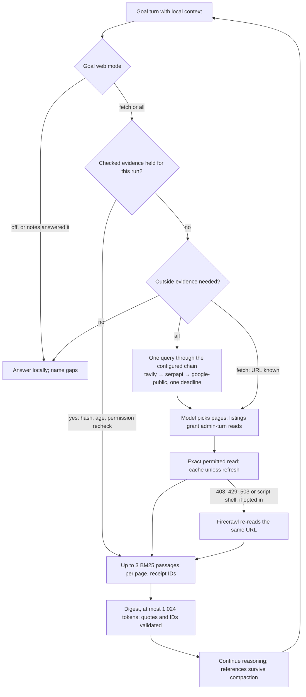

# CG Agent Harness

[](https://github.com/cgfixit/CG-agent-harness/actions/workflows/ci.yml)
[](https://github.com/cgfixit/CG-agent-harness/actions/workflows/bundle.yml)

**An affordable, secure research agent loop on your own machine.** One loopback-only Rust service runs long-form research with a local model: `/goal` and `/loop` carry a question across many turns, `/web research` jobs gather and check evidence from sites you allow, and memory plus Markdown export keep the findings. Affordable: inference is local, cloud calls are optional and priced before they are sent, and every read is bounded by tokens, bytes and time. Secure: outbound reads pass URL rules you wrote; writes, external tools and LAN observation ship off; CI tests enforce the boundaries.

[](docs/screenshots/console-chat-2026-10-30.png)

Fresh home, loopback fixture model. [60-second demo](docs/screenshots/demo/CG-Agent-Harness-60-second-demo.mp4) ([notes](docs/screenshots/demo/voiceover-cues.txt)).

[Quick start](#quick-start) · [Research loop](#how-the-research-loop-decides) · [Invariants](#design-invariants) · [Documentation](#documentation)

## What you can do

| Capability | What it provides | Fresh-home state |
|---|---|---|
| **Web research** | Search listings, permitted fetches and crawls, `/web research` jobs with checked quotes. | On, allowlist mode, one seeded Google rule. |
| **Goal loops** | `/goal` and `/loop` continue a long piece in a run that outlives the browser. | 50 turns, 200,000 tokens, two failed turns; cloud refuses loops. |
| **Memory** | Shared pinned notes, [uploaded notes with retryable cleanup](docs/CONSOLE.md#text-file-attachments-and-prompt-preview), and account-private facts you select, recall or accept from proposals. | On; applying a proposal needs review. |
| **Local chat** | Streaming sessions, transcript search and export, text, DOCX and text-layer PDF attachments, skills, style presets, `/prompt`, sandboxed HTML preview. | Ollama on loopback; no persona or style until you add one. |
| **Analytics, diagnostics** | Session, token and run history, **Estimate draft** before a cloud call, `/diag` redacted log tails. | On; local inference unpriced; `/diag` admin or `portal_auditor` only. |
| **Cloud chat** | Optional Grok or Claude; only the new message leaves. | Needs a provider key. |
| **Off by default** | Reviewed coding in isolated clones, MCP tools and a read-only memory gateway, Netconnect LAN observation. | Each needs explicit configuration. |

Upgrades keep existing choices. The [console guide](docs/CONSOLE.md#what-you-can-do) is the user guide.

## How the research loop decides

Every goal turn follows one path. Permission, budget and deadline decisions are code; the model chooses what to search, which listings to read and what the evidence says.



- **Local first.** Mode `off`, or a notes read you did not ask to go beyond, answers from local context. `fetch` allows exact reads; `all` adds search (`web.goal_web_default` ships `all`).
- **One configured chain.** `web.search.provider` and two fallback flags fix the hop order inside one deadline. `auto` follows your saved keys: Tavily, then SerpAPI, then public Google. Zero results, a rejected key or a refused query never fall through.
- **Digest, then decide.** Quotes and source IDs in the digest are checked before the next tool choice; that proves provenance, not logical support. A failed read goes back to the model as a failure and it answers from what it has. `GOAL_DONE` stays model advice.

Typed read/skip selection and persisted daily provider caps are not built yet ([#772](https://github.com/cgfixit/CG-agent-harness/issues/772)). Design record and measurements: [Web decision router](docs/WEB_DECISION_ROUTER.md).

## Design invariants

Contracts live in [INVARIANTS.md](INVARIANTS.md) and fail `cargo test`, not review ([guard](tests/invariant_guard.rs)).

- **Loopback only.** Non-loopback binds are refused; fresh homes require HTTPS and account login. Research, cloud providers and model runtimes still reach the network.
- **Process isolation (I6).** The console never calls the coding pipeline in-process; it spawns `cgagentharness agentic …` through an allowlisted [shim](src/shim/mod.rs).
- **Writes are gated.** The three write gates ship false; approval, push and publication each need a reason and confirmation, and checks run under Seatbelt or bubblewrap.
- **Web needs current permission.** Reads are DNS-pinned to public addresses and rechecked against URL policy at dispatch, storage and delivery.
- **Strict config.** Gates need literal YAML `true`; malformed numbers stop startup.
- **Secrets stay out.** Provider keys live in the OS credential store and never reach a response, log line or model context.
- **No telemetry.** `deny.toml` bans push-telemetry crates; CI runs `cargo deny` and pins actions.

Accounts are not tenants: other home state is [shared](SECURITY.md#local-authority-and-shared-resources). Details: [Security](SECURITY.md), [Secure research](docs/SECURE_RESEARCH.md).

## Quick start

A **home** is the state directory `~/.CGagentHarness` (`CGAGENTHARNESS_HOME`); run one app or server per home. **macOS, from scratch:** after `xcode-select --install`, `scripts/install-macos.sh` installs Rust, Ollama and the release app, and `scripts/start-macos.sh` opens the app and console ([automated install](docs/INSTALL.md#1-quick-start-automated-macos-install), [browser access](docs/INSTALL.md#7-open-the-console-in-a-browser)).

### 1. Prepare a local model

Any OpenAI-compatible loopback service works. The default `qwen3.8:27b-mlx-cg` is a [locally derived tag](docs/MODELS.md#pin-32768-with-a-local-derived-tag), not bundled. Seeded research budgets assume a **32,768-token window**, and the harness sends no `num_ctx`, so set it before Ollama starts ([Models](docs/MODELS.md)):

```bash
OLLAMA_CONTEXT_LENGTH=32768 ollama serve
```

### 2. Run the harness

**macOS app:** download `CG-Agent-Harness-macos-universal.zip` and `SHA256SUMS` from [Releases](https://github.com/cgfixit/CG-agent-harness/releases/latest):

```bash
shasum -a 256 -c SHA256SUMS
unzip CG-Agent-Harness-macos-universal.zip
open "CG Agent Harness.app"
```

The universal app is ad-hoc signed ([Gatekeeper](docs/DESKTOP.md)). Releases also attach CLI builds.

**Standalone server, macOS or Linux** (Rust 1.89, a C toolchain; [Install](docs/INSTALL.md)):

```bash
git clone https://github.com/cgfixit/CG-agent-harness.git
cd CG-agent-harness
cargo build --release --locked
./target/release/cgagentharness serve
```

Open `https://127.0.0.1:8790/` and trust the local certificate ([guide](docs/SECURE_RESEARCH.md#https-and-native-trust)).

### 3. Sign in and research

1. A fresh home opens **Set your password**: enter the setup code (app: **Setup and recovery**; terminal: `<home>/setup-code`) and a password of 12 or more characters.
2. `/model list`, then `/model use <tag>`; an empty list offers a copyable `ollama pull` command. Run `/status`, send a message, inspect `/prompt`, browse `/help`.
3. `/web allow https://example.org/*`, then `/web research <question>`. For a longer piece, `/goal <question>` and `/loop 3` ([research](docs/SECURE_RESEARCH.md#search-fetch-and-research), [loops](docs/CONSOLE.md#71-sessions-and-bounded-chat-continuation)).

## Commands and configuration

Six public CLI commands, each with `--help`: `serve`, `account`, `web`, `tls`, `mcp-key` and `netconnect`. In the console, `/help` is the searchable guide and the [slash reference](docs/CONSOLE.md#78-slash-command-quick-reference) lists every family.

First launch seeds `config.yaml` from [the defaults](assets/config.default.yaml). Edit that copy and restart, or use **Reload limits** for the [reloadable limits](docs/INSTALL.md#reload-limits-without-a-restart). Contributors: `bash scripts/ensure-githooks.sh` ([hooks](docs/GITHOOKS.md)), then [AGENTS.md](AGENTS.md) and `SKIP_LIVE=1 scripts/verify-local.sh` ([CI](docs/INSTALL.md#tests-and-cicd)). Windows has CI but no release.

## Documentation

| Topic | Guide |
|---|---|
| Setup, models, recovery, reloadable limits | [Install](docs/INSTALL.md), [Models](docs/MODELS.md), [Troubleshooting](docs/TROUBLESHOOTING.md) |
| Chat, loops, attachments, commands | [Console](docs/CONSOLE.md) |
| Research design, web boundaries, certificates | [Web decision router](docs/WEB_DECISION_ROUTER.md), [Secure research](docs/SECURE_RESEARCH.md), [Security](SECURITY.md) |
| Memory behavior and ownership | [Memory](docs/MEMORY_GUIDE.md), [Structured memory](docs/STRUCTURED_MEMORY.md) |
| Coding, jobs, schedules, costs, webhooks | [Coding pipeline](docs/CODING_PIPELINE.md), [Spend and notifications](docs/SPEND_AND_NOTIFICATIONS.md) |
| MCP tools and gateway, LAN observation | [MCP](docs/MCP.md), [Netconnect](docs/netconnect.md) |
| Desktop app, Gatekeeper, reset | [Desktop](docs/DESKTOP.md) |
| API, dependencies, releases | [Routes](docs/API_ROUTES.md), [Dependencies](docs/DEPENDENCIES.md), [Releasing](docs/RELEASING.md) |

## License

[MIT](LICENSE).
