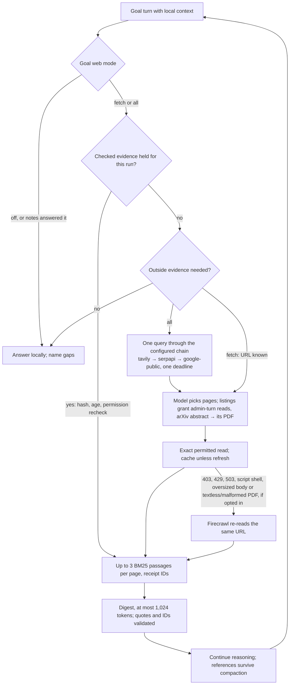

# CG Agent Harness

[](https://github.com/cgfixit/CG-agent-harness/actions/workflows/ci.yml)
[](https://github.com/cgfixit/CG-agent-harness/actions/workflows/bundle.yml)

**An affordable, secure research agent loop on your own machine.** One loopback-only Rust service runs long-form research with a local model: goal loops, evidence-checked web research, browser tasks on sites you name, and memory for the findings. Cloud calls are optional and priced first; every read is bounded and passes your URL rules.

[](docs/screenshots/console-chat-2026-10-30.png)

Fresh home, loopback fixture model. [60-second demo](docs/screenshots/demo/CG-Agent-Harness-60-second-demo.mp4) ([notes](docs/screenshots/demo/voiceover-cues.txt)).

[Quick start](#quick-start) · [Research loop](#how-the-research-loop-decides) · [Invariants](#design-invariants) · [Documentation](#documentation)

## What you can do

| Capability | What it provides | Fresh-home state |
|---|---|---|
| **Web research** | Search, permitted fetches and crawls, `/web research` jobs with checked quotes, local PDF text. | On, allowlist mode, one seeded Google rule. |
| **Goal loops** | `/goal` and `/loop` continue a long piece in a run that outlives the tab. | 50 turns, 200,000 tokens, two failed turns; cloud refuses loops. |
| **Memory** | Pinned and [uploaded notes](docs/CONSOLE.md#text-file-attachments-and-prompt-preview), account-private facts; repeated suggestions are skipped. | On; proposals need review. |
| **Local chat** | Sessions, transcript search and export, text, DOCX and PDF attachments, skills, styles. | Ollama on loopback. |
| **Browser tasks** | `/browse <site> <task>`: the local model drives a sandboxed Chrome on those sites only. Block rules apply to every request and redirect; password fields and anything but GET or HEAD are held, ending the task. | On for administrators; refused without accounts; [setup](#3-sign-in-and-research). |
| **Analytics, diagnostics** | Token and run history, **Estimate draft**, `/diag` redacted logs. | On; `/diag` admin or auditor. |
| **Cloud chat** | Optional Grok or Claude; only the new message leaves. | Needs a provider key. |
| **Off by default** | Reviewed coding in isolated clones, MCP tools and memory gateway, Netconnect LAN observation, Firecrawl fallback reads. | Each needs configuration. |

User guide: [console](docs/CONSOLE.md#what-you-can-do).

## How the research loop decides

Permission, budget and deadline decisions are code; the model chooses searches, which listings to read and what the evidence says.



`all` is the shipped goal web mode. The digest proves provenance, not logical support. A failed read goes back to the model; `GOAL_DONE` stays model advice.

Open phases: [#772](https://github.com/cgfixit/CG-agent-harness/issues/772); measurements: [router](docs/WEB_DECISION_ROUTER.md).

## Design invariants

Contracts live in [INVARIANTS.md](INVARIANTS.md) and fail `cargo test`, not review ([guard](tests/invariant_guard.rs)).

- **Loopback only.** Non-loopback binds are refused; fresh homes require HTTPS and login.
- **Process isolation (I6).** The console never calls the coding pipeline in-process; it spawns `cgagentharness agentic …` through an allowlisted [shim](src/shim/mod.rs). Browser tasks run in their own child with no provider keys.
- **Writes are gated.** Write gates ship false; approval, push and publication each need a reason and confirmation; a revoked gate stops a run at its next iteration; checks run under Seatbelt or bubblewrap, and Linux without bubblewrap refuses unless you opt in.
- **Web needs current permission.** Reads are DNS-pinned to public addresses; policy is rechecked after waits and before dispatch, storage and delivery. Replies render as text, so an injected Markdown image fetches nothing.
- **Strict config.** Gates need literal YAML `true`; malformed numbers stop startup.
- **Secrets stay out.** Keys live in the OS credential store, never in a response, log or model context.
- **No telemetry.** `deny.toml` bans telemetry crates; CI runs `cargo deny`.

Accounts are not tenants ([shared state](SECURITY.md#local-authority-and-shared-resources)).

## Quick start

A **home** is `~/.CGagentHarness` (`CGAGENTHARNESS_HOME`); run one app or server per home. **macOS from scratch:** `scripts/install-macos.sh` installs Rust, Ollama and the app; `scripts/start-macos.sh` opens it ([automated install](docs/INSTALL.md#1-quick-start-automated-macos-install)).

### 1. Prepare a local model

Any OpenAI-compatible loopback service works. The default `qwen3.8:27b-mlx-cg` is a [locally derived tag](docs/MODELS.md#pin-32768-with-a-local-derived-tag). Budgets assume a **32,768-token window**; the harness sends no `num_ctx`:

```bash
OLLAMA_CONTEXT_LENGTH=32768 ollama serve
```

### 2. Run the harness

**macOS app:** download `CG-Agent-Harness-macos-universal.zip` and `SHA256SUMS` from [Releases](https://github.com/cgfixit/CG-agent-harness/releases/latest):

```bash
shasum -a 256 -c SHA256SUMS
unzip CG-Agent-Harness-macos-universal.zip
open "CG Agent Harness.app"
```

The app is ad-hoc signed ([Gatekeeper](docs/DESKTOP.md)).

**Standalone server, macOS or Linux** (Rust 1.89, a C toolchain; [Install](docs/INSTALL.md)):

```bash
git clone https://github.com/cgfixit/CG-agent-harness.git
cd CG-agent-harness
cargo build --release --locked
./target/release/cgagentharness serve
```

Open `https://127.0.0.1:8790/` and trust the [local certificate](docs/SECURE_RESEARCH.md#https-and-native-trust).

### 3. Sign in and research

1. A fresh home opens **Set your password**: enter the setup code (app: **Setup and recovery**; terminal: `<home>/setup-code`) and a password of 12 or more characters.
2. `/model list`, then `/model use <tag>`; `/help` shows the rest.
3. `/web allow https://example.org/*`, then `/web research <question>`. For a longer piece, `/goal <question>` and `/loop 3` ([loops](docs/CONSOLE.md#71-sessions-and-bounded-chat-continuation)).
4. Browser tasks: install Google Chrome, run `PLAYWRIGHT_SKIP_BROWSER_DOWNLOAD=1 npm ci` in `browser/` once, then `/browse docs.python.org what does zipfile.Path do?` ([browser use](docs/Browser-Use.md)).

## Commands and configuration

Public CLI commands, each with `--help`: `serve`, `account`, `web`, `tls`, `mcp-key`, `netconnect`. Console commands: [slash reference](docs/CONSOLE.md#78-slash-command-quick-reference).

First launch seeds `config.yaml` from [the defaults](assets/config.default.yaml); edit it and restart, or use **Reload limits** ([reloadable](docs/INSTALL.md#reload-limits-without-a-restart)). Contributors: `bash scripts/ensure-githooks.sh`, then [AGENTS.md](AGENTS.md) ([CI](docs/INSTALL.md#tests-and-cicd)). Windows has CI but no release.

## Documentation

[docs/README.md](docs/README.md) indexes every guide with the code and tests it owns.

| Topic | Guide |
|---|---|
| Setup, models, recovery | [Install](docs/INSTALL.md), [Models](docs/MODELS.md), [Troubleshooting](docs/TROUBLESHOOTING.md) |
| Chat, loops, commands, memory | [Console](docs/CONSOLE.md), [Memory](docs/MEMORY_GUIDE.md) |
| Research, web boundaries, browser tasks | [Web decision router](docs/WEB_DECISION_ROUTER.md), [Secure research](docs/SECURE_RESEARCH.md), [Browser use](docs/Browser-Use.md), [Security](SECURITY.md) |
| Coding, MCP, desktop app, routes | [Coding pipeline](docs/CODING_PIPELINE.md), [MCP](docs/MCP.md), [Desktop](docs/DESKTOP.md), [Routes](docs/API_ROUTES.md) |

## License

[MIT](LICENSE).
