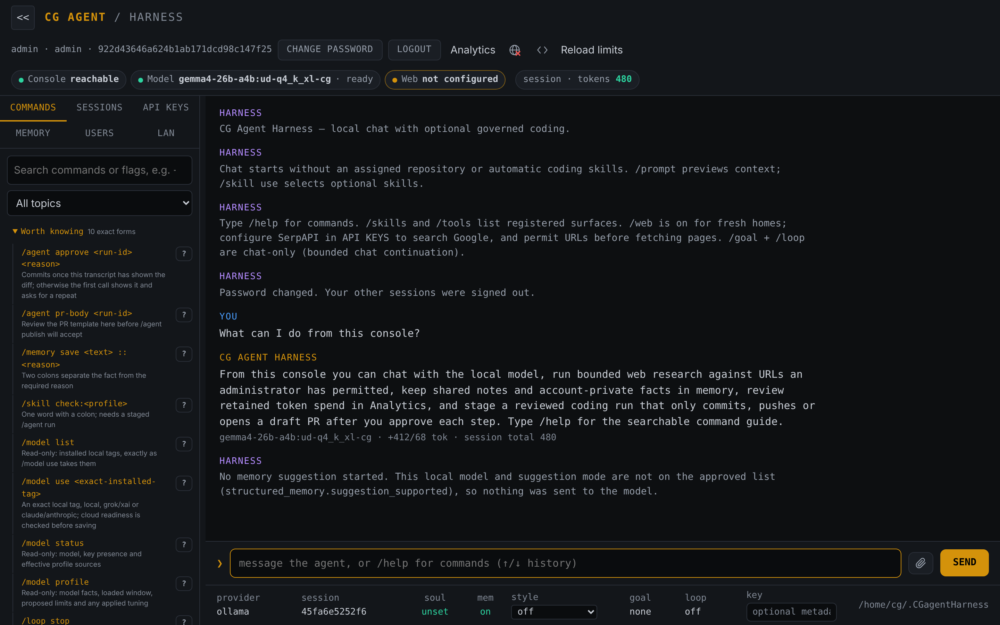

# CG Agent Harness

[](https://github.com/cgfixit/CG-agent-harness/actions/workflows/ci.yml)
[](https://github.com/cgfixit/CG-agent-harness/actions/workflows/bundle.yml)

**Private local chat, permitted web research, and governed coding in one loopback-only Rust service.** A local model answers; web reads stay inside URL rules you set; coding runs land in isolated clones and need your approval to commit, push, or open a draft PR. Nothing leaves the machine unless you turn that on.

[](docs/screenshots/console-chat-2026-10-30.png)

Fresh home, loopback fixture model, 2026-10-30. [Silent 60-second demo](docs/screenshots/demo/CG-Agent-Harness-60-second-demo.mp4) of a synthetic release review in native and web sessions ([notes](docs/screenshots/demo/voiceover-cues.txt)).

[Quick start](#quick-start) · [Engineering choices](#engineering-choices) · [Security and defaults](#security-and-defaults) · [Documentation](#documentation)

## What you can do

| Capability | What it provides | Starting state |
|---|---|---|
| **Local chat** | Streaming sessions with search and export, text and DOCX attachments, prompt skills, `/prompt` inspection, and a sandboxed HTML preview. | Loopback model service; Ollama by default, listed, pulled, and tuned from the console. |
| **Goal loops** | `/goal` and `/loop` continue a task, in the console or as a server-side run that outlives the browser, under turn, token, and failure limits. | Budgets ship unlimited; two consecutive failures stop a run; cloud models refuse loops. |
| **Memory** | Shared pinned notes plus account-private structured facts, recall, and proposed summaries or insights. | Capture, recall, and retrieval on; automatic suggestions only for approved model/mode pairs; applying a proposal needs review ([setup](docs/INSTALL.md#memory-setup)). |
| **Web research** | Search via SerpAPI, public Google, or a loopback SearXNG; permitted page fetches; `/web research` with request, time, byte, and token budgets and checked quotes. | Web on in allowlist mode with an empty allowlist; search listings never authorize page reads; fallback hops ship off. |
| **Reviewed coding** | A planner/executor loop, isolated repository clones, sandboxed checks, complete diff review, and separate Git decisions. | Disabled until configured for a selected repository. |
| **Jobs and schedules** | Detached coding jobs and reviewed interval or cron schedules. | Same coding permissions and owner-bound review. |
| **Analytics** | Retained session, token, and coding-run history with USD where rates exist, plus **Estimate draft** before a cloud call. | On after sign-in; read-only; local inference stays unpriced. |
| **Cloud chat** | Optional Grok or Claude. Sends only the new message, never local history, memory, skills, attachments, or web context. | Requires provider setup; unavailable for `/loop`. |
| **MCP integrations** | Declared external tools and a separate read-only memory gateway with dedicated machine credentials. | Both disabled. |
| **LAN observation** | Netconnect reads in-scope interfaces, routes, and neighbors from local tables. | Disabled with empty scope; only the budgeted `diag` TCP probe sends packets; no scans or device control. |
| **Self-knowledge and diagnostics** | A bundled harness manual and live status block as untrusted local-chat context; `/diag` shows bounded, redacted tails of allowlisted home logs. | Manual on, never sent to cloud chat, `/loop` or `/agent`; `/diag` disabled, admin or `portal_auditor` only. |

Starting states describe fresh homes; upgrades keep existing choices ([console guide](docs/CONSOLE.md#what-you-can-do)).

## How reviewed coding works

1. **Scope.** Select a repository, configure the coding gates, prepare its toolchain.
2. **Stage and confirm.** Give the instruction, branch, allowed reads, and check profile.
3. **Generate and verify.** Bounded edits land in the pipeline's own clone; checks run in a sandbox.
4. **Review.** Inspect the full diff and check results; explicit approval commits.
5. **Publish deliberately.** Push and draft PR creation each need a separate reason and confirmation.

Passing checks never authorize publication; schedules use the same controls ([Coding pipeline](docs/CODING_PIPELINE.md), [Git approval](docs/CODING_PIPELINE.md#git-approval-and-publication)).

## Engineering choices

| Decision | Purpose | Explore |
|---|---|---|
| Separate console and coding processes | Agentic execution sits behind an allowlisted subprocess interface. | [Shim](src/shim/mod.rs), [invariant tests](tests/invariant_guard.rs) |
| Bind approval to reviewed changes | Accepted content, file modes, destination, and commit are rechecked at every Git step. | [Git approval](docs/CODING_PIPELINE.md#git-approval-and-publication), [tests](tests/git_approval.rs) |
| Separate memory proposals from facts | Models suggest; changing canonical facts requires approval. | [Memory guide](docs/MEMORY_GUIDE.md), [tests](tests/structured_memory.rs) |
| Bound external work | Limit research, model calls, subprocess execution, and tool results. | [Configuration](assets/config.default.yaml), [process lifecycle](docs/PROCESS_LIFECYCLE.md) |
| Contracts as tests | Isolation, shipped gates, routes, and doc size fail `cargo test`, not review. | [Invariants](INVARIANTS.md), [guard](tests/invariant_guard.rs) |
| Treat installation as part of the system | The app owns its backend, keeps state outside the bundle, and is identified by commit. | [Desktop](docs/DESKTOP.md), [releases](docs/RELEASING.md) |

**Stack:** Rust, Tokio, Axum, SQLite, Tantivy, and Tauri for the macOS desktop shell.

## Quick start

A **home** is the application's state directory: `~/.CGagentHarness`, overridden with `CGAGENTHARNESS_HOME`. Run one app or standalone server per home.

**macOS, from scratch:** after `xcode-select --install` and a clone, `scripts/install-macos.sh` installs Rust, Ollama, and the release app as needed and builds the backend; `scripts/start-macos.sh` opens the app and console ([automated install](docs/INSTALL.md#1-quick-start-automated-macos-install), [browser access](docs/INSTALL.md#7-open-the-console-in-a-browser)). Below is the manual path.

### 1. Prepare a local model

Pick an installed model that fits your hardware (`ollama list`); the chat default `gemma4-26b-a4b:ud-q4_k_xl-cg` and planner default `qwen3.8:27b-mlx-cg` are [locally derived tags](docs/MODELS.md#pin-32768-with-a-local-derived-tag), not bundled or required.

The default endpoint is `http://127.0.0.1:11434/v1`. Seeded research budgets assume a **32,768-token context window**; for a terminal-managed Ollama service, set it at startup:

```bash
OLLAMA_CONTEXT_LENGTH=32768 ollama serve
```

Restart a running service rather than start a second one; the harness sends no `num_ctx` ([Models](docs/MODELS.md) covers Ollama.app, smaller windows, and pinned tags).

Any OpenAI-compatible service on a loopback address works; chat and the coding planner have separate settings.

### 2. Choose how to run the harness

#### macOS app

Download `CG-Agent-Harness-macos-universal.zip` and `SHA256SUMS` from [Releases](https://github.com/cgfixit/CG-agent-harness/releases/latest), then run from the download directory:

```bash
shasum -a 256 -c SHA256SUMS
unzip CG-Agent-Harness-macos-universal.zip
open "CG Agent Harness.app"
```

The universal app (Apple Silicon and Intel) runs its backend on an ephemeral loopback port and needs no Rust, Python, or browser. Bundles are ad-hoc signed ([Desktop](docs/DESKTOP.md) covers Gatekeeper). Releases also attach prebuilt `cgagentharness-linux-x86_64` and `cgagentharness-macos-arm64` CLI builds with `.sha256` files.

#### Standalone server: macOS or Linux

Source builds use **Rust 1.88** (macOS: Xcode Command Line Tools; Linux: a C toolchain; see [Install](docs/INSTALL.md)). The macOS app build also needs 1.90 ([app build](docs/INSTALL.md#52-macos-app)).

```bash
git clone https://github.com/cgfixit/CG-agent-harness.git
cd CG-agent-harness
cargo build --release --locked
./target/release/cgagentharness serve
```

Open `https://127.0.0.1:8790/` and trust the local certificate ([certificate guide](docs/SECURE_RESEARCH.md)). Non-loopback binds are refused.

### 3. Sign in and try a conversation

1. Fresh homes open **Set your password**: enter the private setup code (app: **Cmd and +** opens **Setup and recovery**; terminal: `<home>/setup-code`) and a new password.
2. `/model list` shows installed tags; `/model use <exact-installed-tag>` selects one and, with `auto_tune` on by default, measures it and sets per-model limits (`/model profile`).
3. Check the header chips (**Console**, **Model**, **Web**; administrators also get the web-policy globe), then run `/status`, send a message, and inspect the assembled context with `/prompt`.
4. Run `/help` for topics, `/help web` for research, or `/help all` for the catalog.

Start coding only after the separate [coding setup](docs/CODING_PIPELINE.md).

## Security and defaults

- **Local access:** fresh homes require HTTPS and account login. The optional harness API key does not replace account authentication.
- **Repository changes:** `agentic.enabled`, `agentic.deepagent_github.enabled`, and `allow_git_write_tools` ship false; some related settings do not, so review the combined policy before enabling execution.
- **Web policy mode:** homes ship in allowlist mode; an administrator can switch the home to block-list mode after a confirmation, after which chat, `/loop`, fetch, and research read any public URL no block rule covers. Private and local addresses stay refused either way.
- **Network boundaries:** loopback binding limits incoming access only; research, cloud providers, subprocesses, and external model runtimes still reach the network.
- **Cloud coding:** six gates end in per-run `--confirm-online`. Requests can send repository excerpts and task context before diff review; redaction does not remove proprietary code.
- **Sandbox differences:** macOS uses Seatbelt. Linux prefers bubblewrap; its `unshare --net` fallback isolates networking without equivalent filesystem confinement.
- **Data scope:** structured memory and sessions are account-owned; other home state is [shared](SECURITY.md#local-authority-and-shared-resources). This is not tenant isolation.
- **Credentials and records:** provider keys default to the OS credential store; audit records use secret-pattern and startup-key redaction and stay under the home.

The target is a local operator workstation; Windows is CI-tested but has no release. Boundaries and limits: [Security](SECURITY.md), [Invariants](INVARIANTS.md), [Secure research](docs/SECURE_RESEARCH.md).

## Command line

Each command supports `--help`.

| Command | Purpose |
|---|---|
| `cgagentharness serve` | Start the console. |
| `cgagentharness account` | Login, password, identity, logout. |
| `cgagentharness web` | URL permissions, search, fetch, research. |
| `cgagentharness tls` | Certificate inspection and renewal. |
| `cgagentharness mcp-key` | Memory-gateway machine keys. |
| `cgagentharness netconnect` | Gate `status`, passive `devices`, and the budgeted `diag` TCP probe. |

## Configuration and verification

First launch seeds the home's `config.yaml` from [the defaults](assets/config.default.yaml); edit that copy. Gates require literal YAML `true`; quoted `"true"` or a missing key is off, and startup logs any shipped-`true` setting your file lacks. Most settings need a restart; selected web and API limits [reload live](docs/CONFIG_RELOAD.md) from **Reload limits**.

Before contributing, run `bash scripts/ensure-githooks.sh` ([hook guide](docs/GITHOOKS.md)) and follow [AGENTS.md](AGENTS.md) for focused verification; for comprehensive checks:

```bash
SKIP_LIVE=1 scripts/verify-local.sh
```

CI adds invariant guards, browser acceptance, sandbox and MCP lifecycle checks, and security scanning ([Tests and CI/CD](docs/INSTALL.md#tests-and-cicd), [Actions](https://github.com/cgfixit/CG-agent-harness/actions)).

**Identify builds by commit**, not the Cargo version `0.1.0`: check `Contents/Resources/COMMIT`, the workflow SHA, and release notes; `main` can be newer than published binaries.

## Documentation

| Topic | Guide |
|---|---|
| Setup, upgrades, backups, recovery | [Install](docs/INSTALL.md), [Troubleshooting](docs/TROUBLESHOOTING.md) |
| Models | [Models](docs/MODELS.md) |
| Chat, attachments, skills, connectors, commands | [Console](docs/CONSOLE.md) |
| Memory behavior and ownership | [Memory](docs/MEMORY_GUIDE.md), [Structured memory](docs/STRUCTURED_MEMORY.md) |
| Coding, jobs, schedules | [Coding pipeline](docs/CODING_PIPELINE.md) |
| External tools and private memory access | [MCP client](docs/MCP_CLIENT.md), [MCP server](docs/MCP_SERVER.md) |
| Passive LAN observation | [Netconnect](docs/netconnect.md) |
| Usage, costs, completion webhooks | [Analytics, spend and notifications](docs/SPEND_AND_NOTIFICATIONS.md) |
| Desktop app, Gatekeeper, reset | [Desktop](docs/DESKTOP.md) |
| Web boundaries and certificates | [Secure research](docs/SECURE_RESEARCH.md), [Security](SECURITY.md) |
| API, dependencies, releases | [Routes](docs/API_ROUTES.md), [Dependencies](docs/DEPENDENCIES.md), [Releasing](docs/RELEASING.md) |

## License

[MIT](LICENSE).
