# Coding pipeline

Optional, disarmed-by-default coding loop ([README](../README.md#design-invariants)).

## 9. (Optional, advanced) Arm the coding pipeline

Complete this section only to authorize work in a repository you select.

```mermaid
flowchart LR
    S["/agent run, or /goal stage"] --> C["/agent confirm reason"]
    C --> W[Owned clone under data/agentic/workspaces]
    W --> P[Local or cloud planner proposes bounded edits]
    P --> V[Fixed check profile in Seatbelt or bubblewrap]
    V -->|check failed, iterations left| P
    V -->|awaiting_review| R["/agent status: complete diff"]
    R --> A["/agent approve reason"] --> U["/agent push reason"] --> D["/agent publish reason: draft PR"]
```



Every arrow after the clone is its own gate; model prose crosses none. The
combined write policy ships closed: `agentic.enabled`,
`agentic.deepagent_github.enabled` and `allow_git_write_tools` are false. Other
settings, such as `mode: write` and `writes_enabled: true`, do not ship false,
so read the whole policy before enabling the master gates.

### 9.1 Install and authenticate the GitHub CLI

Install the [GitHub CLI](INSTALL.md#26-optional-for-the-coding-pipeline-only-github-cli)
if you skipped it, then sign in and confirm:

```bash
gh auth login
gh auth status
```

### 9.2 Edit the configuration file

The first `serve` creates `~/.CGagentHarness/config.yaml` from
`assets/config.default.yaml`. Open it:

```bash
open -e ~/.CGagentHarness/config.yaml
```

Merge these fields into the existing file. Fresh homes set `agentic.repo: ""`;
it is a selector string, not a gate, so name your own `owner/name`. Use the
installed model chosen in [model setup](MODELS.md):

```yaml
agentic:
  enabled: true
  repo: "your-github-user/your-repo"
  mode: "write"
  writes_enabled: true
  deepagent_github:
    enabled: true
    provider: "ollama"
    model: "qwen3.8:27b-mlx-cg"
    allow_git_write_tools: true
    allow_cloud_providers: false
    providers:
      grok:
        enabled: false
      claude:
        enabled: false
```

All five write gates must permit an operation, and approval, push and
publication each need their own reason and confirmation
([contract](../INVARIANTS.md#every-write-to-a-repository-is-gated)). Keep the
cloud-provider child flags false while their parent allow flag is false.
`agentic.gh_timeout_sec` (ships 30) and `gh_retries` (ships 2) bound each `gh`
call; a pair whose worst case reaches the 900-second run setup budget is
refused at load.

Restart after editing the planner model, endpoint, provider, timeout, output
limit or reasoning settings, or the repository retrieval switch. Runs, jobs
and schedules bind to the startup values, and the child refuses changed
settings with exit 3 before any repository work.

### 9.3 Run it from the console

Prepare the selected repository's committed `Cargo.lock` into the same
application home. From the harness checkout:

```bash
python3 scripts/prepare-cargo.py /path/to/selected/repository "$HOME/.CGagentHarness"
```

In the app, **Harness → Setup and recovery → Choose repository and prepare
offline** runs the same helper with a native folder chooser
([desktop setup](DESKTOP.md#finder-setup-and-local-inference)). Preparation
defaults to offline; rerun with `--online` only after reviewing which locked
dependencies are missing. Checks always stay offline
([offline Cargo verification](#offline-cargo-verification)).

Back in the console:

1. `/agent run codex/fix-topic Describe the intended change` stages an instruction.
2. `/agent checks` lists the supported profiles. The server default is
   `cargo-test`; `/agent checks cargo-fmt` selects another.
3. `/agent read src/lib.rs#L40-L80` declares a bounded existing-file window
   (up to 8 staged paths). A **local** planner may also request reads
   ([Bounded edits](#bounded-edits)); a **cloud** planner refuses them, so
   pre-stage what that run may see.
4. `/agent confirm <reason>` submits a job and returns its ID immediately.
5. `/agent job <job-id>` resumes monitoring after a refresh or a new login.
6. `/agent status <run-id>` shows the candidate and its complete diff. A
   truncated diff cannot satisfy console approval.
7. `/agent approve <run-id> <reason>` commits after you have reviewed the diff.
8. `/agent push <run-id> <reason>` pushes the approved branch.
9. Fill in the repository's PR template in a local Markdown file.
   `/agent pr-body <run-id>` selects and previews it; then
   `/agent publish <run-id> <reason>` opens the draft PR.

`/agent cancel` discards only a staged request. `/agent stop <job-id>` requests
cancellation; escaped or interrupted descendants may survive. `/agent reject
<run-id>` rejects a candidate and `/agent discard <run-id>` cleans up a
terminal run.

CLI writes need `--reason=<why> --confirm` (publication also a reviewed
`--body-file`); API writes need `reason`, `confirm: true` and, for publication,
`body`. A combined approve/push/publish request is refused
([Git approval and publication](#git-approval-and-publication)).

### 9.4 Stage a session goal as a coding task

With the repository, tools and write configuration above in place:

```text
/goal Fix the arithmetic bug and pass the declared Cargo test
/goal stage codex/arithmetic-fix
/agent read src/lib.rs#L40-L80
/skill check:cargo-test
/agent iterations 1
```

Staging stores a reviewable goal and branch request and creates no worker;
review it before `/agent confirm <reason>`. One iteration is the default.

`/goal task` shows progress or restores an unsubmitted stage after a page
refresh. The server binds submission to the current goal and stage; a changed
goal or a duplicate submission is refused, so inspect the existing job before
staging another.

A checked candidate reports **awaiting_review**. `/agent status <run-id>` shows
the complete diff, ignored and attribute-hidden changes included
([approval binding](../INVARIANTS.md#approval-is-bound-to-what-was-reviewed)),
and `/agent approve` is a separate decision. **completed_local** means
checked-tree evidence and an approved commit, not a push, a publication or
proof of every subjective goal.

Reopening a session never replays execution or approval. Changing or clearing the chat
goal does not cancel an authorized coding job: `/agent stop <job-id>` does.

### 9.5 The kill switch

To disable writes for a newly launched backend without editing its config, set
this before launch:

```bash
export CGAGENTHARNESS_AGENTIC_WRITE_DISABLE=1
```

`1`, `true`, `yes` and `on` block writes regardless of YAML; the switch cannot
enable them. It is read at process start, so restart with it set, or revoke
`agentic.writes_enabled` to block later mutation boundaries in an active child.
Neither cancels a running Git command or check.

## Bounded edits

Declare each file the task needs with `--read-file src/lib.rs`, or one inclusive
line window per file with `--read-file 'src/lib.rs#L590-L630'`
(`/agent read src/lib.rs#L590-L630` in the console). Missing, unsafe, oversized
and omitted selections are reported explicitly.

During a **local** planner run the model may also emit `=== READ path ===` or
`=== READ path#Lstart-Lend ===`. Those lines are stripped before proposal
parsing, jailed like operator selections, capped at 6 accepted model selectors
per run and shown on the **next** iteration only. They are data, not commands:
they bypass no confirm, reason or write gate and never replace
operator-declared paths. An unclosed `=== FILE ===` or `=== EDITS ===` block
leaves later READ lines in the body instead of extracting them.

After clone-jail canonicalization, operator and model selectors are refused
when any path segment is `.git` name-equivalent, or when the final segment
matches `agentic.deepagent_github.denied_read_basenames` (default `.env` and
`.env.*`, `*.pem`, `id_rsa*`, `id_ed25519*`, `id_ecdsa*`, `credentials*`,
`.npmrc`, `.netrc`, `*.p12`; name-equivalence folded). The jail stops path
escape and clone Git metadata reads. Neither it nor the deny-list is a secret
scanner: secrets can use any name.

Read ceilings are 4,000 characters per file and 12,000 in total, under a
256,000-byte internal file-read ceiling. Context carries the full-file SHA-256
and a completeness flag. A later attempt takes a fresh snapshot, and having
written a file earlier never authorizes blind replacement, so predeclare new
paths a correction may need to read.

For existing large files the planner can emit:

```text
=== EDITS ===
{"edits":[{"path":"src/lib.rs","sha256":"<provided hash>","old":"<unique displayed text>","new":"<replacement>"}]}
=== END EDITS ===
```

Use JSON escapes and one edit per file. `old` must be nonempty, unique in the
whole original (overlapping matches included) and inside the displayed excerpt.
A hash mismatch, hidden or ambiguous text, duplicate destinations, invalid
JSON, mixed block formats or an incomplete trailing marker rejects the whole
proposal. `FILE` blocks are for new files or fully displayed originals; they
cannot overwrite a partially viewed file.

Model output is judged before it lands. `real_repo_loop.rs` applies the
injection, edit-budget and protected-path decisions to all final replacement
content, and `workspace.rs::apply_proposal` rechecks protected destinations and
aggregate size before staging, with exact-content binding on each edit. Raw,
canonical and landed destinations pass protected-path policy, including Unicode
and case equivalents, and proposal writes refuse symlink ancestors and leaves.
`deepagent_github.protected_write_paths` is a refusal list, not a scope edits
must stay inside. Protected tests and build configuration have no
tests-directory exemption: existing tests may be read, and new protected tests
arrive through operator-authored PRs. Do not weaken that policy to get a
proposal accepted.

Replacements are staged, originals rechecked, then renamed. A later
application error rolls back earlier replacements; a failed rollback is fatal,
quarantines the run and keeps its recovery backup. Checks see the batch only
after it applies, and a failed Cargo check feeds bounded stdout and stderr into
the next attempt.

This is not crash-atomic or safe against a concurrent writer, so do not edit
an active disposable clone. `tests/exact_edits.rs` drives a real offline
Seatbelt Cargo failure and its exact correction.

## Optional repository retrieval

To supply relevant files without hand-selecting every path, merge this into the
home's `agentic.deepagent_github` mapping and restart:

```yaml
agentic:
  deepagent_github:
    retrieval:
      enabled: true
      max_files: 256
      max_index_bytes: 2000000
      top_k: 3
      excerpt_lines: 40
      token_budget: 2048
```

It ships **off**; an absent, quoted or non-boolean `enabled` stays off.
Retrieval is local-planner-only and grants no execution authority: the staged
request, `/agent confirm <reason>`, sandboxed checks, diff review and separate
approvals all remain. Cloud planners never receive retrieved files, and
`/agent read` and accepted model READ requests take priority.

Each step, the child lists tracked and non-ignored untracked paths, examines at
most `max_files` in lexical order and builds a Tantivy RAM index over bounded
UTF-8 source. It retrieves at most `top_k` files, re-reads each one and
includes it only if its full SHA-256 still matches. Lexical search does not
guarantee coverage: use explicit windows for large repositories, synonyms or
long lines.

| Setting | Accepted range | Bound |
|---|---:|---|
| `max_files` | 1–1024 | Candidate paths examined per step, including paths later excluded |
| `max_index_bytes` | 1–16,000,000 | Total indexed UTF-8 source bytes per step |
| `top_k` | 1–8 | Additional candidate files |
| `excerpt_lines` | 1–200 | Maximum line window, also clipped by character budgets |
| `token_budget` | 256–8192 | Conservative UTF-8-byte reservation including rendered headers |

Reservations are not vendor token usage, and the per-file and aggregate
[read ceilings](#bounded-edits), the clone jail and the denied-basename rules
apply before indexing. Leaf symlinks, paths escaping the clone, `.git`
name-equivalent segments, binary or invalid UTF-8, oversized files, unsafe path
text and injection-scanner hits are excluded. Tracked files stay candidates
even if a later ignore rule names them.

`/agent status <run-id>` shows each step's indexed counts, whether a bound
limited selection, and the selected lines, hashes and reserved bytes. The run
record and audit keep only that metadata; source is not copied to the web cache
or indexed with sessions or structured memory.

## Cloud planner data egress

With `deepagent_github.allow_cloud_providers` and a provider enabled,
`--confirm-online` sends the real working context for each iteration, not a
short plan prompt. Per attempt, `real_repo_loop.rs` assembles:

- the operator's instruction and the approved plan, if staged;
- the prior attempt's check-failure feedback;
- a bounded excerpt of every source file the run declared or read with
  `/agent read`, within the [read ceilings](#bounded-edits) (a `#L10-L40`
  selector sends only that window);
- the GitHub text of a selected `/agent pr` or `/agent issue`, fetched and
  injection-scanned only when selected.

A cloud planner never expands that read set from model `=== READ ===` output
(`apply_model_read_request` refuses with `cloud_proposer`).
`CloudProposerClient::invoke` passes the assembled prompt through
`sanitize_handoff`, an injection scan plus secret-pattern redaction (built-in
shapes and `policy.privacy.redact_secrets_like`), then sends it to `api.x.ai`
or `api.anthropic.com`. Redaction catches known secret shapes only. It does not
strip proprietary source, comments or issue content, and none of that data is
reviewable before it leaves the machine. Treat enabling a cloud provider as
authorizing repository-content egress for every later `--confirm-online` run.

Cloud proposals require an explicit normal completion: Grok
`choices[0].finish_reason: "stop"` or Claude `stop_reason: "end_turn"`.
Truncated, missing, malformed or continuation states are refused before any
proposal is applied, even when the returned prefix holds a complete edit block.
These billed 2xx responses are recorded once as `failed_after_billing` and
never retried automatically. Reduce the task or raise
`agentic.deepagent_github.planner_max_tokens` before retrying.

## Offline Cargo verification

The operator prepares dependencies; untrusted checks never fetch them. Tool
discovery runs from the filesystem root, outside the candidate. Select an
installed compiler through `PATH` and, for rustup, `RUSTUP_TOOLCHAIN`: candidate
toolchain files cannot select executables, and preparation never installs a
toolchain or model.

Prepare once per lockfile and application home, as in
[Run it from the console](#93-run-it-from-the-console). Both modes need an
existing `Cargo.lock` and installed cargo/rustc/rustdoc, and neither runs build
scripts or tests. `cargo vendor` writes a locked source snapshot under
`data/agentic/cargo-prepared/<lock-sha256>`. An existing snapshot is refused,
never overwritten; use a separate disposable home to prepare again, and keep
home and snapshot outside the candidate. The snapshot records the concrete
toolchain and macOS SDK, linker and runtime paths, so moving those
installations means preparing again.

Run the harness with `CGAGENTHARNESS_HOME` set to that home, and keep
`Cargo.lock` unchanged in proposals: new dependencies need a separately
reviewed preparation, and no model retry can make uncached dependencies
available. Missing components or sources, permission failures and Cargo
timeouts are setup errors; compile and test failures are feedback for a
correction.

### Execution boundary

Every verification creates and removes owned scratch holding HOME, CARGO_HOME,
build outputs and temporary files; the real user home and credentials are not
passed through. Cargo receives the prepared source configuration, an explicit
compiler and rustdoc, `--frozen` (except `cargo fmt`) and
`CARGO_NET_OFFLINE=true`.

On macOS, Seatbelt denies network operations, loopback included. Candidate
files, `.git`, vendor sources, toolchain and runtime inputs are read-only, and
file reads are limited to those inputs, scratch, named OS and SDK roots and the
system OpenSSL configuration file. The whole home, `/usr/local`,
`/opt/homebrew`, `/private` and `/Library` are not granted. Only scratch is
writable, so tests that generate source-tree artifacts must use the supplied
temporary directory: granting candidate writes would expose Git metadata and
hooks to build scripts.

Seatbelt is not a memory or disk quota, and escaped descendants remain a
[lifecycle limit](PROCESS_LIFECYCLE.md). Linux bubblewrap applies its own
allowlisted read-only filesystem with writable scratch; the `linux-netns`
fallback and Windows Job Objects provide no filesystem policy, and native
Windows acceptance is unverified.

### Required native gate

```sh
# Authorized preparation, outside verification:
cargo fetch --locked
cargo fetch --locked --manifest-path tests/fixtures/cargo-sandbox/Cargo.toml
# Actual native offline verification, with cloud test credentials empty:
GROK_API_KEY= ANTHROPIC_API_KEY= DEEPAGENT_API_KEY= CARGO_NET_OFFLINE=true \
  cargo test --test macos_cargo --locked --offline -- --nocapture
```

Run on macOS outside an outer sandbox that prohibits nested Seatbelt; a missing
sandbox capability fails the gate. The tests build real fixtures and verify
denied outside, symlink, candidate, Git and cache access, a blocked loopback
listener, scratch cleanup and refusal of stale prepared inputs.

**Linux confinement evidence.** Linux CI fails if `bwrap` is missing. The
ordinary test matrix may report a classified confinement skip when a
GitHub-hosted runner refuses `RTM_NEWADDR`; that is not confinement proof. The
separate `Linux bubblewrap confinement (required)` job runs the suite in a
pinned container with namespace and mount capabilities, where
`CGAH_REQUIRE_LINUX_BWRAP` makes every probe failure fatal. Its probes must show
candidate reads and scratch writes working, secret reads, symlink reads and
candidate writes denied, and a connection to an owned host listener refused
from inside a different network namespace. Docs-only pull requests
(`scripts/ci-docs-only.sh`) skip compile jobs, this one included; the invariant
guard still runs.

## Git approval and publication

The retained clone is data, including its local Git configuration and index.
Approval must commit the bytes and modes that were reviewed, and push and
publication must keep referring to that approved commit.

Ordinary Git commands do not guarantee that: pre-staged files can enter a
commit, a literal `*` filename can match neighbors, hooks and clean filters can
run, and replacement refs can reinterpret the base tree. Workspace operations,
manifest reads and disposable verification therefore use one Git helper. It clears ambient variables, global and system config and
system attributes; disables hooks, fsmonitor, signing, maintenance and
replacement objects; and uses literal pathspecs. Local config is limited to
ordinary clone metadata: includes, custom programs, filters, transport rewrites
and unsupported metadata refuse without echoing values. Read-only diff
inspection accepts inert local external-diff and fsmonitor settings.

Authenticated `gh repo clone` also gets isolated Git settings and an empty Git
template. Publishing uses the installed `gh auth git-credential` helper for
HTTPS; a GitHub.com SSH origin can use the operator's SSH configuration and
keys. Custom credential helpers and enterprise hosts are refused; absolute
local remotes remain available for offline runs.

Approval refuses staged changes and index locks. Under the normal index lock it
builds a private index from the accepted base, inserts only the accepted raw
blobs and modes and writes that tree, so replacement objects and grafts cannot
reinterpret the base. Acceptance digests include mode. A failure after a
durable branch commit is indeterminate and needs inspection.

Content-transforming attributes (`filter`, `text`, `eol`,
`working-tree-encoding`, `ident`) are refused for selected changes, which
deliberately excludes LFS and newline-normalizing workflows.

Run records pin the origin and approved commit. Push refuses changed branches
or destinations and sends an object-ID refspec to the pinned URL. Publication
reads the remote branch, refuses mismatches and opens the draft against the
branch the clone checked out (its recorded `origin/HEAD`), not a fixed `main`.
Every operation rechecks write policy, reason and confirmation. Older unpinned
records cannot be pushed, though inspection and cleanup still work.

`tests/git_approval.rs` covers these cases in disposable repositories; it is
not an exhaustive Git security audit. The index lock coordinates normal Git
writers, not a hostile process that ignores locks.
Remote readback is point in time: another authorized actor can change the
branch later. Abrupt death and escaped descendants keep the
[process-lifecycle](PROCESS_LIFECYCLE.md) limits.

## Isolation check

The HTTP server reaches agentic execution only through the twelve
`shim::ACTIONS`, and `tests/invariant_guard.rs` checks every non-agentic tree
against `src/agentic` in both directions
([I6](../INVARIANTS.md#i6--process-isolation-between-the-console-and-the-agentic-pipeline)).
Child exit codes are the entire interface; a signal death reports `-1` plus a
stderr line naming the signal. `writer.rs` is a separate gate from
[bounded edits](#bounded-edits): it guards the single executable GitHub write
op (`gh pr create`, always `--draft`).
