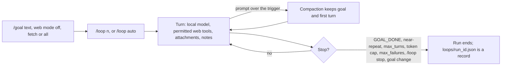

# Chat, soul, skills and slash commands

See [setup](../README.md), [memory](MEMORY_GUIDE.md), and
[web operations](SECURE_RESEARCH.md#search-fetch-and-research).

Chat continuation and coding jobs differ: `/goal` and `/loop` run bounded
follow-up turns in chat, while `/agent` drives the [coding pipeline](CODING_PIPELINE.md).
Commands call fixed, validated interfaces: a goal, skill, persona, or reply
never becomes a shell command or authorizes commits, pushes or publication.

## What you can do

| Capability | How it works |
|---|---|
| Chat and sessions | Separate saved conversations with token counts. **Clear my session history** deletes yours after confirmation; derived structured-memory episodes remain unless you confirm that cascade too. |
| Persona, memory and prompt context | `/prompt` previews the next turn; shared `soul.md`, session prompt skills and literal `/memory` notes feed it. Account-private structured memory has separate gates; models propose but never approve ([memory guide](MEMORY_GUIDE.md)). |
| Chat model selection | A local tag, `local`, `grok/xai` or `claude/anthropic`. Cloud needs an enabled provider, active key and confirmation; only new text leaves, and `/loop` refuses cloud (`CLOUD_CHAT_LOOP`). [Profiles](MODELS.md). |
| Chat web tools | Keyword search (public Google, SerpAPI or Tavily, per `web.search.provider` and the saved key) and permitted URL fetch, with the opt-in Firecrawl fallback for exact reads ([search providers](SECURE_RESEARCH.md#google-search)). |
| Web research | `/web research` answers from permitted pages with checked quotes, usage and partial coverage. Fresh homes allow only Google search. |
| Accounts and API Keys | Administrator, Portal operator and Auditor permissions are enforced on API reads and writes; administrators manage masked credentials in API Keys ([accounts](SECURE_RESEARCH.md#accounts-and-roles)). |
| Coding and review | Stage a task, confirm an isolated run with sandboxed checks, review the diff, then approve, push and publish separately ([coding pipeline](CODING_PIPELINE.md)). Reopening rediscovers retained jobs and runs; nothing resumes or republishes. |
| Analytics and webhooks | `/analytics` shows read-only tokens, cost, sessions and coding runs with **Estimate draft**. Metadata-only completion webhooks stay off, and the **Job webhooks** button hidden, until configured ([spend and notifications](SPEND_AND_NOTIFICATIONS.md)). |

Text follows browser zoom. In the sidebar tab list, arrow keys, Home and End move
and Enter or Space opens a tab. Drag its right edge to resize; drag far left to
hide it, or focus the divider and use the same keys. The top-left **>>** restores
it. Width lasts until reload. The conversation is a polite live log, marked busy
while a reply streams.

## 7. Chat, soul, skills and goals

Fresh chat has no assigned repository or automatic coding skills. When web is
enabled, local chat, including local `/loop` turns, can dispatch only the
bounded read-only `web_search` and `web_fetch` tools. Chat cannot inspect local
files or certify live wiring; use command results as evidence and the coding
workflow for execution. Existing homes retain repositories and skill files, but
chat neither loads nor edits legacy coding skills.

Enter slash commands in chat; `/help` lists them. Begin with `/status`,
`/model`, `/skills all`, and `/tools`; registration is not
[readiness](#77-tools-and-connectors-available-versus-catalog-only). For an
isolated test, start `/session new`, `/skill clear`, then inspect `/prompt`: a
new session still uses enabled shared notes and persona.

### 7.1 Sessions and bounded chat continuation

```text
/session new Setup check
/goal --web off Explain the attached test strategy
/goal
```

`/tokens` and the header's **session · tokens** show the tally
([interpretation](SPEND_AND_NOTIFICATIONS.md#read-spend-without-mistaking-missing-data-for-zero)).

Creating or switching sessions replaces the visible transcript, stops chat,
discards delayed replies, and clears staged coding or persona reviews. A new
session has no messages, goal, or prompt skills. Persona and enabled notes stay
shared; your account's web selection and injected context survive session
changes. The HTML editor button, beside the web-policy globe, previews the
draft for the open chat as a separate page that runs the draft's own style and
script but cannot call this console. Reset controls differ in scope:

| Intent | Control | Retained data |
|---|---|---|
| Clear the visible output | `/clear` | Saved messages, session ID and goal remain, and later chat still receives recent history. Staged reviews and loop state clear. |
| Start a separate conversation | **+ new session** or `/session new <title>` | Old sessions, shared persona/notes/model selection and your web selection remain. |
| Delete my saved conversations | **Clear my session history**, below **+ new session** | Shared notes/persona/web, model configuration, coding runs and audit records remain. |

**Delete my session history** in the dialog stops active chat and deletes your
saved sessions, goals, skill selections, token totals, attachments and uploaded
notes, retaining other accounts, unassigned legacy records and unreadable
files. Deletion may be partial if storage fails, and it is not secure erasure:
backups, model-service copies and text loaded in other clients remain.

In the composer, Up recalls older prompts; Down moves forward or restores the
draft. Every submitted line enters history, refused commands included; `/api`
keeps only its key name and `/loop` turns are skipped. The session log keeps the
latest 50 across restart; the browser stores nothing.

The session store retains at most 500 messages per conversation, dropping the
oldest whole exchanges after the first exchange or its summary. A model reply
that opens with `[session-compacted]` is stored with a leading space, so only
[compaction](#local-history-compaction) writes a summary. Stored token totals
can exceed what is sent to the model.

```text
/loop 3
/loop 3 compare hvac vendors
/loop auto --web fetch 2 summarize the release notes
/loop stop
/goal clear
```



Bare `/loop` defaults to three turns within the configured cap.
[`loop.*` limits](INSTALL.md#reload-limits-without-a-restart) reload;
`api.harness_loop_rate_limit.max_tokens` bounds each reply, and while
`auto_tune` has tuned the model a loop reply never exceeds
`models.local_llm.max_tokens`. When both configured caps are zero or absent,
`/status` and loop preflight warn without blocking: set a finite cap, then
**Reload limits**.

Text after the count sets the goal; otherwise a goal-less loop takes the last
prompt. Manual mode pauses between turns. `/loop auto` toggles automatic
continuation: turning it on with a goal (or last prompt) to follow starts the
loop after 5 s, as does `/goal <text>` while auto is on or `/loop auto` with a
count, mode or goal. A turn that needed compaction continues automatically.
`/loop stop` cancels generation, cooldown or a pending start. Goal clear,
session switching, token budgets, a 90%-identical reply or `loop.max_failures`
consecutive failed turns (default 2; auto retries once) stop it. A `GOAL_DONE`
line (even `**GOAL_DONE**`) stops it too, but is only model advice.

With `server_loop` in `/api/status`, auto loops outlive tabs: the console
reattaches through the [loop routes](API_ROUTES.md#chat-model-and-chat-sessions),
and turns persist under the home's `loops/`.
Runs recheck account authority each turn and retain bounded, revalidated
[web evidence references](SECURE_RESEARCH.md#chat-web-tools) through compaction.
Manual, older-server, compaction-started and attachment loops remain browser-driven.

A server-side turn waits while another generation holds the local model (your
own chat message, a memory consolidation, the `auto_tune` sample) instead of
counting a failure. `/loop stop` ends the wait; after two hours the run ends
`failed`, naming the busy model. A turn that still loses the model before its
own claim is retried, uncounted, up to three times in a row. Ordinary chat
never queues: a busy model refuses it with `CHAT_BUSY`.

This loop does not edit files, run skills as programs, or run coding checks.
`--web` on `/goal` or `/loop` sets the chat tools of every turn while the goal is
set; without it the goal takes `web.goal_web_default` (ships `all`,
restart-only). `fetch` excludes search, `off` excludes web context and tools.
Listings grant admin-turn exact-URL reads (`web.search.result_reads.enabled`)
only. Preflight shows the mode.
A server restart does not resume a loop; goal-to-coding execution
is the separate [goal staging](CODING_PIPELINE.md#94-stage-a-session-goal-as-a-coding-task) workflow.

#### Search and export session transcripts

The Sessions pane's **Search my transcripts** box and per-row **Export .md**
buttons call guarded APIs, not `/session` subcommands.
`POST /api/sessions/search` takes `{"query":"exact phrase"}` (200 characters,
up to 32 terms) and searches a request-local Tantivy RAM index of at most 200
owned sessions and 2,000,000 bytes. It returns at most 16 hits, two per
session, as 160-character snippets of literal case-insensitive phrases. Search
writes no web cache and sends nothing off-machine. A hit opens its session;
session or account switches discard results.

`GET /api/sessions/{session_id}/export` returns Markdown, written to
`<home>/exports/{id}.md`. Browsers offer a download; the app reports the saved
path. Export includes attachment metadata only. Both enforce owner and CSRF.

### 7.2 Default soul, effective prompt and persona editing

**Fresh homes leave the global persona unset** (shown as **unset**). Existing
files and deliberate deletions are preserved. The reference persona in `assets/soul.default.md` is
never loaded implicitly: chat, the coding planner and cloud prompts carry no
persona unless `soul.md` exists and the toggle is on. Private persona edits are
never sent to a cloud coding provider.

```text
/soul status
/prompt
/soul edit
```

`/soul status` reports enabled, present, loaded, truncated, and a safe failure
reason. `/prompt` opens a private snapshot of the next local chat turn. The
system prompt comes first: general-chat header, an operator-command guide and
inclusion settings, selected prompt skills, enabled persona, the active output
style, session goal, explicitly injected web context, the live status block
and enabled memory notes. Below it is the context that turn sends fenced ahead
of your new message (`<<<TURN_CONTEXT>>>`): earlier web reads, selected or retrieved memory facts,
bundled-manual excerpts, attachment and notes excerpts, and a staged `/diag`
excerpt. These change with each message, so sending them with it lets a local
runtime reuse the prompt it already read. They are counted with the message,
never stored in the session, and stay untrusted reference text; `/loop` turns
keep one system prompt. No credentials file is included, and responses are
`Cache-Control: no-store`. The preview is not a transcript or the coding
planner's prompt.

To create or change persona, open `/soul edit`, enter bounded text
([example](#74-customize-response-style)) and a reason, select **Preview
prompt**, review it, tick the confirmation checkbox and **Save persona**. Then
`/soul on` if needed, and `/soul status` and `/prompt` to verify.

Edits save to `<harness home>/soul.md`; default maximum is 8,000 characters
(`personality.soul_max_chars`). Empty, oversized, invalid and critical
instruction-override content is refused. A stale revision cannot overwrite
newer content: reload the editor and review again. Persona text never
authorizes code execution. `/soul off` disables inclusion without deleting the
file.

**History and proposals:** replacement is atomic and saves the previous content
as a private SHA256-named backup. `/soul history` lists backup revisions; the
guarded API `GET /api/soul/document?version=<revision>` reads one for
restoration through the same confirmed edit. `/soul propose` opens a
proposal-only editor: **Create proposal only** stores supplied or
model-authored text without applying it and returns an ID.

```text
/soul review <proposal-id>
/soul apply <proposal-id> <reason>
```

Review first. Apply confirms the displayed revision with the supplied reason;
there is no second dialog. `/soul reject <proposal-id> <reason>` preserves the
active persona. A changed base, changed proposal, or decided proposal is refused.
Backup and proposal storage holds 32 records without automatic deletion.

Apply records proposal and content hashes in `soul-pending-apply.json` before
replacement and removes the marker after saving proposal status. Startup and
the next persona operation reconcile matching candidate content as `applied`,
unchanged base content as `pending`, and unrelated content as `interrupted`,
writing no persona text. Unreadable recovery storage blocks startup and persona
operations: preserve `soul.md`, `soul-history/` and the marker before manual
repair. Recovery covers process interruption, not power loss or concurrent
external edits.

### 7.3 Runtime skills and Codex development skills

| Kind | Location / selection | What it does |
|---|---|---|
| Seeded coding context | `<home>/skills/ponytail` and `karpathy-guidelines` | Loaded only by explicit `/skill use ponytail karpathy-guidelines` |
| Optional runtime prompt skill | `<home>/skills/<id>/SKILL.md`; `/skill use <id>` | Adds bounded context to this session's chat |
| Fixed check | `/skill check:cargo-test` | Selects a known check for an already staged coding request; no immediate execution |
| Governed catalog entry | `/skills all` | Inventory only unless an implemented adapter says otherwise |

To add optional context, create a normal file in the **active home**, e.g.
`skills/review-notes/SKILL.md`; links cannot escape the skills directory:

```markdown
---
name: Review notes
---
When explaining a change, identify its observable behavior and a targeted check.
```

Then select its **directory ID**, not its display name:

```text
/skills all
/skill use review-notes
/skill status
/prompt
```

IDs allow lowercase ASCII letters, digits, hyphens and underscores, up to 80
characters. Selection replaces the session's optional list; supply all wanted IDs
in one `/skill use <id...>`. Up to four are retained, with defaults of 6,000
characters per body and 16,000 total (`personality.prompt_skill_max_chars`,
`personality.prompt_skills_total_chars`). Frontmatter is stripped.

After chat, `/skill status` reports the last successful snapshot's IDs, sizes
and SHA256 hashes, which can differ from current files. A missing,
empty, unreadable, or invalid selected file blocks chat; restore it or
`/skill clear`, which removes selections (seeded ones included), not files.

Repository development skills under `.claude/`, `.codex/` and `.github/` are
indexed in [AGENTS.md](../AGENTS.md#project-skills); they never enter app chat.

### 7.4 Customize response style

Use soul for your usual voice across sessions and a runtime skill for one
task; neither changes permissions. Write the voice you want with `/soul edit`,
save it through the [soul review flow](#72-default-soul-effective-prompt-and-persona-editing),
then compare answers in `/session new Style check` (`/clear` is not a fresh
session). Style guarantees neither length nor correctness; avoid contradictory
rules across soul, [runtime skills](#73-runtime-skills-and-codex-development-skills)
and memory.

**Style presets.** `/style <name>` selects a session preset, `/style off` is
the default and `/style` prints the active one. Shipped in
[`data/styles/`](../data/styles/): `concise`, `technical`, `research`,
`code-review`, `design`, `troubleshoot`, `handoff`, `verify` and `extract`
(supplied documents only). An overlay at
`$CGAGENTHARNESS_HOME/styles/<name>.md` wins. Prompt order is soul, style, then
fixed policy, so style cannot override the contract; an explicit format request
wins over a preset. `off` removes only style. `/prompt` reports load failures
and omits an unreadable, empty, missing, or scanner-refused overlay.

Local chat and `/prompt` also carry a live status block and bundled-manual
excerpts (`diagnostics.self_knowledge`, `live_state`); a message of only
stopwords selects no excerpt
([contract](../INVARIANTS.md#self-knowledge-never-widens-authority)).

**The `unslop` planner probe** is not a chat preset: an optional local
coding-planner probe (`unslop.enabled: true` plus `metrics_path:
"logs/unslop.jsonl"`, restart) that counts 16 fixed phrases such as "delve" in
proposals and may nudge another iteration. It never rewrites an answer, applies
to cloud planners, or scores quality ([probe](../src/agentic/unslop.rs)).

### 7.7 Tools and connectors: available versus catalog-only

`/tools` separates route registration, known enablement, and readiness. Listing
does not probe a model, invoke GitHub, or arm writes. `last_result: null` means
no invocation history; registered or legacy `wired` does not prove readiness.
`/tools mcp` shows external MCP declarations, read/write grants, network policy,
and process-group or unrestricted Windows Job Object exceptions, without
executing a tool ([MCP capabilities](MCP.md#outbound-client-capabilities)).
`/connectors` and `/registry` are inventories only.

| Capability | Boundary |
|---|---|
| Public web text | Search listings, permitted fetch, page research and optional context injection ([web](SECURE_RESEARCH.md#search-fetch-and-research)) |
| GitHub coding | A separate governed child-process workflow behind `agentic.repo` and its gates; `/github` reports status, and a chat reply runs no Git command ([coding pipeline](CODING_PIPELINE.md)) |
| Local file context for coding | `/agent read <repo-relative-path[#Lx-Ly]>` before confirmation: bounded reads from the governed clone, no general filesystem mount |
| `netconnect` | Gates ship false. Read-only LAN panel with no scan button; `/net diag` runs the budgeted probe, and an empty scope refuses armed tiers ([netconnect](netconnect.md)) |
| Log diagnostics | `/diag` (admin or `portal_auditor`; `diagnostics.logs_enabled` ships true): bounded, redacted tails of allowlisted `<home>/logs/` files, one excerpt staged for the next local turn ([diagnostics](TROUBLESHOOTING.md#diagnostics)) |
| `fsconnect`, `sqlconnect` | Not implemented: no slash command, datasource picker, filesystem indexing, database connection or YAML switch |
| `github-public`, `openai-compatible` catalog entries | Inventory only; neither is a connector or an activation control |

The Setup folder chooser prepares offline Cargo inputs, not chat file access
([connector inventory](../src/server/views.rs)).

### 7.8 Slash-command quick reference

Angle brackets mean "replace with your value", square brackets are optional
and `|` separates alternatives. The Commands pane folds the catalog by family
under a search box and topic filter; `/help all` prints it, and `/help` opens a
topic overview filtered by a topic key or search words. A row's `?` opens the
command's manual. Commands, examples, suggestions and **Insert into composer**
only insert the fixed prefix (`/agent approve `), never execute. Unknown flags,
`--dry-run` and `--confirm` cannot authorize an action. These are console
commands, not a shell: nothing is expanded, substituted or run as a script. A
command must be one line without control characters, U+FEFF, zero-width spaces
or bidi overrides.

Memory commands require an exact `/memory` root and subcommand
(case-insensitive). `/mem`, typos and conversational forms such as
`/memory please retrieve preferences` only suggest; they never read memory, start
chat, toggle gates or write notes. Exact save/remember require `:: <reason>`,
split at the final `::`; exact clear/forget delete pinned notes, so inspect the
command before sending.

Typed slash commands require the server parser; a parser failure leaves the
command unexecuted, and pending parses are discarded on a session, account or
transcript change. Exact `/loop stop` still cancels continuation while the
parser is unavailable.

| Command family | Supported use |
|---|---|
| `/agent [help]` | Inspect coding commands; full workflow below |
| `/analytics` | Open read-only session, token and coding-run [analytics](SPEND_AND_NOTIFICATIONS.md#analytics-sessions-tokens-and-coding-runs) |
| `/api`, `/api set <KEY> <value>`, `/api clear <KEY>` | Inspect, save or clear a managed credential; prefer the API Keys password fields; [persistence](INSTALL.md#8-persistence-optional-keys-and-recovery) |
| `/clear` | Clear visible output, staged coding/review state and chat continuation; saved chats, notes, persona and web context remain |
| `/connectors` | Connector catalog; does not activate connectors |
| `/diag [status]`, `/diag audit\|spend\|unslop\|errors [flags]`, `/diag inject\|forget` | Read allowlisted logs or stage one excerpt; aliases `/diagnostics`, `/logs`; [diagnostics](TROUBLESHOOTING.md#diagnostics) |
| `/github` | Read-only agentic GitHub status |
| `/goal`, `/goal [--web off\|fetch\|all] [text]`, `/goal clear` | Inspect, set or clear the saved session goal and its web mode |
| `/goal stage <branch>`, `/goal task` | Explicitly stage coding from a goal or inspect its task linkage |
| `/harness` | List retained optimizer runs; does not start optimization |
| `/help [topic\|search words\|all]` | Searchable topic guide, full command catalog and insertable examples |
| `/loop [auto] [--web off\|fetch\|all] [n] [goal text]`, `/loop stop` | Goal-driven chat continuation; goal text sets the goal first; `auto` toggles and starts after 5 s; exact `stop` also cancels a streaming chat turn |
| `/memory`, `status`, `on`, `off`, `add <note>`, `forget <id>`, `clear` | Shared pinned notes; [operator memory notes](MEMORY_GUIDE.md#pinned-notes) |
| `/memory capture\|recall\|retrieval\|auto-retrieve\|consolidation\|auto-consolidate\|auto-suggest-chat\|auto-suggest-coding on\|off` | Administrator-only structured-memory gate overrides; `on` or `off` is required. `/memory on` stays pinned notes |
| `/memory consolidate <episode-id> [episode-id ...]` | Selected-episode consolidation into pending proposals; does not apply facts |
| `/memory proposals` | Open the Memory panel; Apply/Reject requires review and a reason |
| `/memory remember <sentence> :: <reason>` | Confirm a semantic summary on the latest completed episode; no fact write |
| `/memory facts`, `/memory retrieve <query>`, `/memory search <query>` | List your active facts, start a turn with explicit retrieval, or list candidates without injection |
| `/memory save <text> :: <reason>` | Confirm an immediate private fact write |
| `/model [status]`, `profile`, `list`, `use <name>` | Inspect/profile/list/select a local chat model or explicit cloud provider; does not select the coding planner |
| `/net status`, `/net devices`, `/net diag` | Read-only scope and gates, passive neighbors, or the budgeted diagnostics probe. Aliases and refused tier words: [netconnect](netconnect.md) |
| `/prompt` | Private preview of the next local chat turn's prompt |
| `/registry` | Combined skill, tool and connector catalog |
| `/session`, `list`, `info`, `new [title]`, `rename <title>`, `unpin`, `use <id>` | List, inspect, create, rename or reopen sessions; `unpin` clears attachment pins |
| `/skill`, `status`, `use <id...>`, `clear` | Inspect, replace or clear session prompt-skill selection |
| `/skill check:<profile>` | Select one fixed check for an already staged coding request |
| `/skills [all\|help\|<name>]` | Wired skills, the full catalog including optional prompt files, help, or skills matching a display name (not always the `/skill use` directory ID) |
| `/soul`, `status`, `on`, `off`, `edit`, `history`, `propose` | Inspect, toggle or open persona editing/proposal flows |
| `/soul apply <id> <reason>`, `reject <id> <reason>`, `review <id>` | Review a retained proposal, then apply or reject its exact revision |
| `/status` | Runtime status and unlimited-loop warning; account access required |
| `/style`, `/style <name>`, `/style off` | Inspect/select a session output style, or clear it without changing soul.md |
| `/tokens` | Current session token tally |
| `/tools [all\|help\|mcp\|<name>]` | Registered tools, the full catalog including unwired entries, help, external MCP grants, or one named tool |
| `/users` | Administrator account panel; [accounts](SECURE_RESEARCH.md#accounts-and-roles) |
| `/web [status\|help]`, `/web on`, `/web off` | Inspect shared-home rules; administrators enable/disable web |
| `/web allow <pattern> [pattern ...] [--group name] [--seed URL ...]`, `/web deny <id-or-pattern>` | Administrator grants are atomic; repeat `--seed` per concrete seed. Every seed must fit a requested rule |
| `/web mode allowlist\|denylist`, `/web block <pattern-or-host> [...]`, `/web unblock <id-or-pattern>` | Administrator. The header globe (red X) switches modes after a confirmation dialog. `denylist` reads every public URL except blocked rules; a host with no path blocks it and its subdomains. Both lists persist across switches |
| `/web check <URL> [URL ...] [--group name]` | Exact permission diagnostic, with no network request or grant |
| `/web cancel`, `/web fetch <URL> [URL ...] [--group name] [--crawl]`, `/web forget`, `/web inject` | Cancel research; fetch permitted URLs (`--crawl` follows links); clear/select extracts |
| `/web job [id]`, `/web jobs` | Show the newest or one owned detached research job, or list them; jobs outlive the tab, not a restart ([research](SECURE_RESEARCH.md#fetch-discovery-and-research)) |
| `/web pages [--group name] <query>`, `/web research [--group name] [--url URL ...] <question>` | Permitted-page discovery or local-model research; repeat `--url` per starting point; no new authority |
| `/web search [--count 1..10] [--engine google\|pages] [--group name] <query>` | Google listings by default; a group selects permitted-page search |

Web value flags accept `--flag value` or `--flag=value`; `--help` opens help
without mutation. In queries `-tokio` is text; put `--` before words starting
`--`. Legacy `group=name` and `allow PATTERN GROUP SEED` remain accepted.
Unknown, repeated or missing-value flags refuse; fetch takes URLs, not prose.
Misspellings only suggest: ambiguous `/skil` offers both `/skill` and
`/skills`. Supported conversational prefixes keep the query words:
`/web please search The Who` becomes `/web search The Who`. Unsupported fixed
arguments such as `/memory clear --help` remain unexecuted.

The `/agent` family operates the separate coding workflow:

| Command | Effect |
|---|---|
| `/agent run <branch> <instruction>` | Stage a request for inspection; does not start it |
| `/agent checks [profiles]` | List fixed profiles, or select space/comma-separated profiles |
| `/agent iterations <n>` or `clear` | Set a staged iteration cap from 1–10, or restore the configured default |
| `/agent pr <number>` or `/agent issue <number>`; `clear` | Select one context source; choosing one clears the other |
| `/agent plan` or `/agent plan clear` | Open a file chooser for a supplied plan, or clear it; does not generate a plan |
| `/agent read <repo-relative-path[#Lx-Ly]>` or `clear` | Stage up to 8 bounded file-context declarations, or clear them. Denied basenames (`.env`, keys, credentials, …) refuse operator and model reads alike; a cloud planner refuses model-requested and [retrieval](CODING_PIPELINE.md#optional-repository-retrieval) reads. The deny-list is not a secret scanner. |
| `/agent cancel` | Clear the staged request; does not stop an already submitted job |
| `/agent confirm <reason>` | Explicitly submit the staged request through the execution gates |
| `/agent jobs`, `/agent job [job-id]`, `/agent stop [job-id]` | List, monitor or request cancellation; an omitted ID uses the retained job from the URL |
| `/agent runs`, `/agent status <run-id>` | List runs or inspect a run and its diff |
| `/agent approve <run-id> <reason>` | Review then approve the exact candidate; repeat only after reading a newly displayed diff |
| `/agent reject <run-id>` | Reject a candidate |
| `/agent push <run-id> <reason>` | Separately authorize pushing the approved commit |
| `/agent pr-body <run-id>` | Choose a reviewed PR body file |
| `/agent publish <run-id> <reason>` | Separately authorize PR publication with the selected body |
| `/agent discard <run-id>` | Clean up a terminal run's owned clone |

Fixed check profiles map to these commands; selection neither installs their
prerequisites nor runs them:

| Profile | Fixed command |
|---|---|
| `cargo-test` (default) | `cargo test --quiet` |
| `cargo-clippy` | `cargo clippy --all-targets -- -D warnings` |
| `cargo-fmt` | `cargo fmt --check` |
| `pytest` | `python3 -m pytest -q --tb=short` (`python` on Windows) |
| `ruff` | `python3 -m ruff check --select E,F,I,B,C4,UP,S .` (`python` on Windows) |

Arbitrary shell check commands are not accepted. Python profiles need their own
prepared tools; native Cargo verification uses the prepared offline sandbox in
[coding pipeline](CODING_PIPELINE.md).

### Text-file attachments and prompt preview

The paperclip beside Send chooses up to three `.txt`, `.md`, `.json`, `.csv`,
`.log`, `.docx` or `.pdf` files, each at most 15 MiB; other formats are refused. `/prompt` uploads
and previews their fenced, untrusted text, and the next message sends their IDs
once. A failed preview retains them; a session or account change clears them.
Uploads count toward the home quota until session or owner cleanup, and clipped
sections say they are incomplete.

Sessions retain at most 12 owner-scoped blob IDs. The next local turn may
BM25-search them and inject matching passages into the attachment fence.
`.md`, `.txt` and `.pdf` notes ingested at `/api/notes-corpus` use a separate home jail
but share that local prompt budget (`source=notes_corpus`). Local loops include
these sources; cloud chat and `/agent` refuse attachment IDs or live pins with
`ATTACHMENT_SURFACE_FORBIDDEN` and never receive notes-corpus bytes.
`/session unpin` clears session references, keeping blobs.

Loop startup reports live pins, web availability and uploads. A repeating
refusal (no URL permitted, keyless search, no budget for a round) stops
continuation; one failed read is reported and the loop continues until two
turns' reads all failed. A browser-driven loop waits out a rate limit's
`retry_after` (up to 300 s; `/loop stop` ends the wait); a server-side run
counts it as a failed turn.

Open **Memory → Manage uploaded notes** to upload, refresh or delete your
account’s `.md`, `.txt` and `.pdf` notes. The picker shows configured limits and reports skipped
files; the server accepts or rejects a batch together. Saved notes use
reference IDs, not filenames. A local message supplies the retrieval query, and
`/prompt` shows matching passages. Notes stay separate from facts and pins.

Incomplete history-clear or account-deletion cleanup reports `notes_cleanup`
and a `notes_corpus_cleanup_incomplete` audit event, without note names or text.
Failed unlinks, and stale rows after a failed index save, stay charged;
retrieval skips missing blobs, while unreadable or altered blobs still refuse.
Restore storage access, then clear history again or delete the listed notes.
Deleted accounts' notes retry at server start or the next account deletion;
unindexed orphan files are not found.

### DOCX attachments

The file picker also accepts `.docx`. Only UTF-8 main-document text is read:
paragraphs, tables, explicit tabs and breaks. Directly hidden/deleted runs and
field instructions are excluded. Headers, footers, images/OCR, style-based
visibility, macros and embedded files are not interpreted; relationships and
URLs are never followed.

DOCX uses the same 15 MiB/file, three-file request, home quota, owner checks,
injection scan, private UUID storage and local-chat-only fence as text uploads.
Magic bytes, package layout, content type and XML namespaces must agree. The
reader refuses ZIP64/split archives, ambiguous entries, trailing payloads,
custom entities/DTDs, non-UTF-8 XML and malformed or empty documents. Fixed
safety ceilings: 256 parts, 256 KiB directory, 16 MiB declared expansion,
64 KiB content-types XML, 1 MiB document XML/output, and 128 XML levels.
A two-second cooperative deadline bounds parsing in process.

### PDF text

Attachments, notes and exact web reads extract page text without OCR, images,
forms, links, scripts or embedded files. Nearby inline fragments rejoin by
position; columns follow stream order. Refetch cached PDFs.

Ligatures fold, hyphenated breaks join, and running headers and page numbers
drop. The first line lists textless pages; `# Page N` marks passages. Unmatched
queries sample evenly spaced page openings.

Refusals: `PDF_MALFORMED`, `PDF_ENCRYPTED`, `PDF_NO_TEXT`, `PDF_LIMIT` (15 MiB,
200 pages, 8 MiB decoded per stream or page, 32 MiB per file, 1 MiB text),
`PDF_TIMEOUT` (5 s per file, 10 s per upload or prompt), `PDF_BUSY`,
`PDF_WORKER_FAILED`. Parsing runs in a [killable child](../INVARIANTS.md#i6--process-isolation-between-the-console-and-the-agentic-pipeline)
with a 768 MiB heap. Size caps: `notes_corpus.max_pdf_bytes`, text within
`max_file_bytes`; `web.pdf_response_bytes`, within a run's remaining `run_bytes`.

### Streaming chat and cancellation

The console requests `POST /api/chat` with `Accept: text/event-stream`; clients
without it get JSON responses and HTTP errors. Both modes share authentication,
CSRF, generation gates, web tools, memory selection, and exchange persistence.

Each SSE `data` field contains one JSON event:

- `{"type":"delta","text":"..."}`: provisional model text.
- `{"type":"done","data":{...}}`: the complete chat response, including
  session identity, usage, tally, web events and memory metadata.
- `{"type":"error","status":502,"error":{"detail":{...}},"headers":[]}`:
  a typed failure after SSE headers were sent. The event carries the
  application status and any retry headers; the HTTP stream itself is 200.

The console shows deltas, then replaces them with the `done` answer. Failed or
cancelled partial text is removed and not persisted. Streams require a completion
reason and `[DONE]`; malformed or truncated output fails.

`/loop stop` (`POST /api/chat/cancel`) cancels the account's chat or
browser-driven loop turn; `POST /api/loop/stop` halts a server-side run.
Closing the stream aborts its task, releases claims, and drops model and web
requests, without promising immediate GPU release.

Tool calls are accumulated and validated before dispatch. Owner and URL
permission are rechecked before each evidence-derived delta and final delivery.
Revocation cannot retract delivered text. Model traffic has a 4 MiB ceiling and
request deadline; a bounded channel applies backpressure within that deadline.

### Local history compaction

Before local chat or `/loop`, the harness estimates the next prompt plus one
reply. Above `chat.compact_prompt_tokens` (default 24000), it summarizes middle
turns, keeping the first user message, goal, and whole recent exchanges (at most
`chat.compact_keep_messages`, seeded 10, and `chat.compact_tail_percent`, 25% of the
trigger). Unless `chat.compact_follow_window: false` (seeded), an `auto_tune`-verified
window above 32768 scales the trigger within `chat.compact_max_prefill_sec`
(seeded 1500) of measured prefill. The summarizer reads goal and first message, keeps the prior summary
whole, clips other turns at 800–4000 characters within its budget, else history
stays. The model gets a lossy note yielding to
exact messages; unsourced codes become `[unverified]`.

Reply reservation is `max_tokens` for resolved Ollama with explicit
`reasoning_effort: "none"`, or twice that otherwise: a conservative
margin, not provider accounting. The trigger counts one reply on every
backend; a doubled reservation can still compact sooner, at the hard limit. Startup accepts at most 25904 reply tokens on
the first path or 12952 on the second for chat and `/loop`. The trigger floor,
web-chat tightening and the calibrated bytes/4 estimate are specified in
[INVARIANTS.md](../INVARIANTS.md#local-chat-compaction-preserves-goal-and-the-first-user-turn).
The estimate counts the message as sent, including its fenced turn context, and
the evidence a `/loop` web turn restores before its first model call.
Calibration cannot predict language shifts or ratios above 3; verify the
model window per [MODELS.md](MODELS.md).

`compaction.summary_max_tokens`: seeded 2048, missing-key fallback 768, clamped 128–2048.
Edit home `config.yaml`, then restart. Compaction is inline;
empty, failed, truncated, or cancelled output commits neither summary nor
calibration. Past the trigger a turn may still send up to the hard limit, the
prompt cap (web chat: the web room): an empty or cut-off summary, or too little
to summarize, sends it uncompacted, and the response's `compaction_skipped`
says why. A new message alone must fit the trigger. A prompt over its limit returns
`CHAT_PROMPT_TOO_LARGE` (422) naming the bounding setting (`details.limit_source`),
the turn's reply budget (`models.local_llm.max_tokens`, or
`api.harness_loop_rate_limit.max_tokens` for `/loop`) and only remedies that can help.
A new session cannot help when the system prompt and reply reservation fill the limit.
