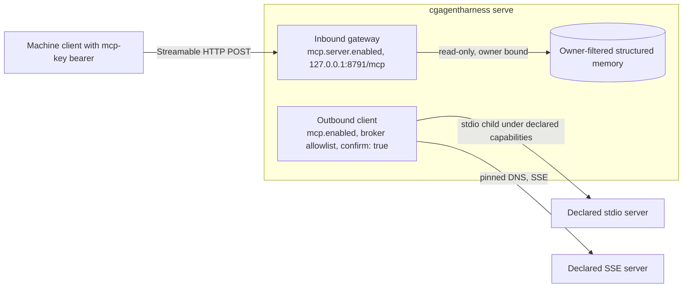

# MCP: external tools and the private memory gateway

The harness speaks the Model Context Protocol on two independent surfaces, both
shipped off. The **outbound client** (`mcp.enabled`) calls tools of servers an
operator declares in `config.yaml`. The **inbound gateway**
(`mcp.server.enabled`) serves three read-only memory tools to machine clients
on its own loopback listener. Neither inherits the other's keys, grants or
listener, and `/loop` never receives MCP tools.



## Outbound client capabilities

A call needs an authenticated operator or administrator, CSRF, a declared
namespaced tool in the broker allowlist and literal `confirm: true`. Discovery,
models and repositories cannot expand declarations.

## Migrate a stdio declaration

A stdio declaration without `capabilities` refuses startup; an upgrade grants
no ambient access. Declarations are restart-only.

Keep `config.yaml` private ([configuration storage](INSTALL.md#home-and-optional-credentials)).
An `env` value or a complete SSE `url` may be a whole-value `env:NAME` taken
from the inherited environment ([resolution rules](../INVARIANTS.md#provider-keys-live-in-the-os-credential-store)).
Blocked destination names are stripped, and reserved harness-secret or
runtime-hijack source names are refused for both transports. API Keys cannot
store arbitrary MCP variables.

```yaml
mcp:
  enabled: true
  sse_allow_loopback: false
  timeout_sec: 15
  max_result_bytes: 65536
  servers:
    - name: documents
      transport: stdio
      command: [/usr/bin/python3, /srv/mcp/server.py]
      tools: [lookup]
      capabilities:
        version: 1
        filesystem: confined
        read_roots: [/srv/mcp/server.py, /srv/documents]
        write_roots: []
        network: deny
        containment: strict
        limits:
          processes: 32
          memory_mb: 256
```

`timeout_sec` (1–60) and `max_result_bytes` (1024–262144) refuse a malformed or
out-of-range value at startup without echoing it; a missing key keeps the default.

Replace the example paths with deliberate grants: at most 16 roots, absolute,
without `..` or the filesystem root, re-canonicalized for each call. Confined
policies refuse the harness home and every overlap. Optional `cwd` is a
read-only grant; omit it for an empty owned directory. Declare scripts, modules
and non-system runtimes explicitly, because arguments grant no paths. Host
writes stay in owned scratch and write roots; on Linux a write to private
namespace storage such as `/tmp` does not touch the same-named host path.

`network: deny` is mandatory unless the operator selects `unrestricted`, which
allows every destination the OS allows: subprocess networking does not use the
web URL allowlist or DNS pinning. Missing fields, unknown versions, fields or
enums, invalid limits and unavailable protections fail closed, including a
failed Linux network-namespace probe.

## Lifecycle choices

| Policy / host | Behavior |
|---|---|
| `strict`, Linux | systemd service + cgroup v2 + bubblewrap; requires usable process and memory controllers |
| `strict`, macOS / Windows | refuses before the declared program runs |
| `process_group`, macOS | Seatbelt filesystem/network policy; weaker lifecycle exception |
| `process_group`, Linux | bubblewrap filesystem and selected network policy; weaker lifecycle exception |
| `process_group`, Windows | refuses; filesystem confinement is unavailable |
| `job_object`, Windows | trusted-server exception: unrestricted filesystem/network, process-tree ownership and resource limits |
| `job_object`, macOS / Linux | refuses before execution |

Strict mode requires `processes` 8–128, `memory_mb` 64–4096, cgroup v2 and
systemd 254 or newer. Counts include supervisor and runtime processes. The
harness uses the existing service manager, never sudo; missing controllers or
permissions refuse.

For weaker cleanup on macOS or Linux, set `containment: process_group` and omit
`limits`. That exception promises neither aggregate resource limits nor cleanup
after runner death or a detached descendant, and `/tools mcp` displays it
([lifecycle details](PROCESS_LIFECYCLE.md#explicit-mcp-lifecycle-policy)).

### Read-only host files on macOS

Strict containment refuses on macOS, so a read-only filesystem server uses
`process_group` without `limits`:

```yaml
    - name: host-files
      transport: stdio
      command: [/opt/mcp/fs-server, /Users/me/diag-share]
      tools: [read_file]
      capabilities:
        version: 1
        filesystem: confined
        read_roots: [/opt/mcp/fs-server, /Users/me/diag-share]
        write_roots: []
        network: deny
        containment: process_group
```

Each call still needs `confirm: true`; limits are in
[read-only host inspection](TROUBLESHOOTING.md#read-only-host-inspection).

## Explicit Windows trusted-server exception

Windows cannot enforce this client's filesystem/network sandbox policy. Only
for a trusted server, an operator can deliberately declare:

```yaml
capabilities:
  version: 1
  filesystem: unrestricted
  network: unrestricted
  containment: job_object
  limits: {processes: 8, memory_mb: 256}
```

Use an absolute native `.exe` command; batch files are refused. Root lists must
be empty because they cannot restrict this mode, and a missing `filesystem`
defaults to `confined`, which refuses the exception. Limits use the strict
Linux ranges; memory covers the whole job. The backend reports
`windows-job-object-unrestricted` and the console warns that account-accessible
secrets are readable: this trusted program can open other paths and contact
services, including ones such as WMI that run outside the job. Only
configuration selects the exception
([job ownership](PROCESS_LIFECYCLE.md#explicit-mcp-lifecycle-policy)).

## Inspect and troubleshoot

`/tools mcp` and `GET /api/mcp` show declarations and grants without spawning
or claiming readiness. A success audits backend, policy and probe result; a
refusal audits policy and error code. Arguments, results and environment
secrets stay out of the audit.

| Result | Meaning |
|---|---|
| `CONFIG_ERROR` at startup | Missing/invalid capabilities; repair the declaration before restarting |
| `MCP_CAPABILITY_REFUSED` | A granted path is unavailable or exposes a strict control boundary |
| `MCP_HOME_REFUSED` | Command path, working directory or grant overlaps the harness home |
| `HARD_SANDBOX_UNAVAILABLE` | Required filesystem/network protection cannot execute |
| `MCP_CONTAINMENT_UNAVAILABLE` | Strict OS ownership/limits cannot be established |
| `MCP_TIMEOUT` | The overall invocation deadline expired |

SSE declarations keep DNS-pinned URL checks and the separate, default-off
`sse_allow_loopback` grant; they receive no stdio filesystem grants.

## Private read-only memory gateway

The gateway runs in the harness process over the owner-filtered memory store
and listens separately from the console; it opens no second database and does
not expose the portal. No home has an inbound listener unless
`mcp.server.enabled` is literal `true`, and `mcp.server.tools` defaults empty.
The supported tools are `memory_list_facts`, `memory_get_fact` and
`memory_search`, each needing a `memory:read` key. There is no write, session,
notes, spend, audit, agent, chat or loop tool.

## Deliberate local activation

1. Stop the backend. On Unix the home must be owned by its user with mode
   `0700`; change an older `0755` home first.
2. Enable structured memory and select exactly the tools to publish:

   ```yaml
   structured_memory:
     enabled: true
   mcp:
     server:
       enabled: true
       host: 127.0.0.1
       port: 8791
       tools: [memory_list_facts, memory_get_fact, memory_search]
   ```

   Merge these fields into the existing configuration. Every gateway field is
   restart-only; a port collision or invalid value refuses startup.
3. Mint a key with the local CLI for an account's stable `user_id`
   (`GET /api/auth/whoami`, or `GET /api/auth/users` as administrator), or
   `local` on an auth-disabled home. The account must be enabled and past its
   setup code:

   ```sh
   cgagentharness mcp-key create --owner YOUR_OWNER_ID --label workstation \
     --confirm --reason 'Allow this workstation to read the selected memory namespace'
   ```

   The CLI acts on local filesystem authority, not as a console administrator,
   so `issued_by_user_id` is null. Store the one-time bearer token in protected
   client storage, never in config, URLs, logs or screenshots.
4. Start `cgagentharness serve` or the app, and point the MCP client's
   Streamable HTTP POST at `http://127.0.0.1:8791/mcp` with
   `Authorization: Bearer <token>`. Use the literal configured IP and port:
   `localhost` is a different Host authority and is refused.

The exact-pinned `rmcp` SDK ([version](DEPENDENCIES.md#retained-constraints))
serves stateless Streamable HTTP. SDK traces are suppressed because they can
contain memory; audits record only key IDs, tool names and coarse outcomes.

## Keys, isolation and revocation

Machine keys are independent of console users and cookies, even with account
authentication off. A key has a public 128-bit ID and a random 256-bit secret;
only the secret's SHA-256 hash is stored and it is compared in constant time,
with a dummy comparison for unknown or disabled keys. Keys live in a dedicated
`mcp_keys.sqlite3` with an `mcp_keys.initialized` marker; auth and memory
schemas are unchanged. On Unix both files must be owner-owned regular mode-0600
files with no symlinks or hard links. Windows applies no mode check or database
ACL and relies on the home's private ACL and SQLite's no-follow open. Missing,
corrupt, oversized or unknown-schema storage refuses instead of recreating
credentials.

```sh
cgagentharness mcp-key list
cgagentharness mcp-key revoke KEY_ID --confirm --reason 'Retire workstation access'
```

Listing returns metadata only. `mcp-key create` refuses a missing or disabled
owner or one still on its setup code, and accepts only `local` with account
authentication off. Disabling or deleting an account disables its keys. A later
request sees a revocation and rechecks it before a memory read, though a read
already executing may finish. Owner binding is immutable: mint a new key to
rotate. At capacity (`max_keys`), revoke an old key; rotation removes the
oldest disabled rows. Creation and revocation leave content-free audit events.

The stored row alone supplies the owner. Every query filters on it, hides
inactive facts and gives foreign and unknown IDs the same result. Search is a
bounded literal substring, not FTS or a query language. Returned memory is
untrusted data, not tool authority or instructions.

## Bounds and failures

| Restart-only setting | Default | Accepted range |
|---|---:|---:|
| `max_keys` | 8 | 1–32 |
| `max_request_bytes` | 16384 | 1024–65536 |
| `max_result_bytes` | 65536 | 1024–262144 |
| `max_results` | 32 | 1–64 |
| `max_query_chars` | 256 | 1–512 |
| `request_timeout_sec` | 5 | 1–30 |
| `concurrency` | 2 | 1–8 |
| `requests_per_minute` | 120 | 1–120 per key |
| `global_requests_per_minute` | 360 | 1–600 total, including invalid keys |

Limits sit under `mcp.server`. Rates use fixed one-minute windows.
Authentication, body read and response collection share the request deadline,
and store work holds its concurrency permit until it completes even if the
caller times out. The body limit applies to streamed bodies regardless of
Content-Length; an oversize response fails without a partial fact. List and
search read the store's latest 256 active facts and return at most
`max_results`: they are not an archive export.

Only direct loopback peers and the exact configured Host authority are
accepted, and any Origin or forwarding header is refused: the endpoint is for
machine clients, not browser JavaScript. Cookies never authorize it and a
machine key never authorizes console routes. Plain HTTP stays on loopback; no
proxy, tunnel, port mapping or remote listener is installed.

## Future remote exposure requires a separate reviewed change

There is no remote mode. LAN, overlay or public exposure needs a separately
reviewed change covering interface selection, TLS, machine identity, Host and
Origin rules, load bounds and rollback. Each new tool needs its own capability
and tests, and none may write canonical facts or inherit coding authority.
