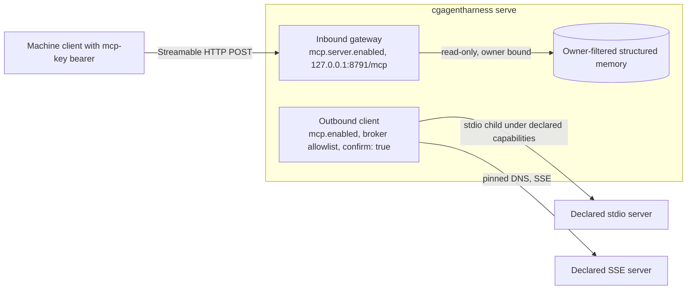

# MCP: external tools and the private memory gateway

The harness speaks the Model Context Protocol on two independent surfaces. The
**outbound client** calls tools of servers an operator declares in `config.yaml`;
`mcp.enabled` gates it. The **inbound gateway** serves three read-only memory
tools to machine clients on its own loopback listener; `mcp.server.enabled`
gates it. Neither inherits the other's keys, grants or listener, and `/loop`
never receives MCP tools. Both ship off.



## Outbound client capabilities

Calls need an authenticated operator or administrator, CSRF, a declared
namespaced tool in the broker allowlist, and literal `confirm: true`. Discovery,
models and repositories cannot expand declarations; disabled or undeclared MCP
stays off.

## Migrate a stdio declaration

Stdio declarations need `capabilities` or startup refuses. Review paths and
lifecycle policy; upgrades grant no ambient access. Declarations require
restart, outside `RELOADABLE`.

Keep `config.yaml` private; see [configuration storage](INSTALL.md#home-and-optional-credentials).
An `env` value or complete SSE `url` accepts whole-value `env:NAME` from the
inherited environment ([resolution rules](../INVARIANTS.md#provider-keys-live-in-the-os-credential-store)).
Blocked destination names are stripped; reserved harness-secret/runtime-hijack
source names are refused for both transports. API Keys cannot store arbitrary
MCP variables.

```yaml
mcp:
  enabled: true
  sse_allow_loopback: false
  timeout_sec: 15
  max_result_bytes: 65536
  servers:
    - name: documents
      transport: stdio
      command: [/usr/bin/python3, /srv/mcp/server.py]
      tools: [lookup]
      capabilities:
        version: 1
        filesystem: confined
        read_roots: [/srv/mcp/server.py, /srv/documents]
        write_roots: []
        network: deny
        containment: strict
        limits:
          processes: 32
          memory_mb: 256
```

`timeout_sec` (1–60) and `max_result_bytes` (1024–262144) refuse a malformed or
out-of-range value at startup without echoing it; a missing key keeps the default.

Replace the example paths with deliberate grants. At most 16 roots are accepted.
Roots must be absolute, exclude `..` and the filesystem root, and are
re-canonicalized for each call. Confined policies refuse the harness home and
all overlaps. Optional `cwd` is a read-only grant; omit it for an empty owned
directory. Declare scripts, modules, and non-system runtimes explicitly because
arguments grant no paths. Host writes stay in owned scratch and write roots.
Linux also has private namespace storage (including `/tmp`); a write there does
not modify a same-named host path.

`network: deny` is mandatory unless the operator explicitly selects
`unrestricted`. Missing fields, unknown versions/fields/enums, invalid limits
and unavailable protections fail closed. The unrestricted grant includes all
destinations the OS allows; subprocess networking does not use the web URL
allowlist or HTTP DNS pinning. Linux never silently drops network isolation
when its network namespace probe fails.

## Lifecycle choices

| Policy / host | Behavior |
|---|---|
| `strict`, Linux | systemd service + cgroup v2 + bubblewrap; requires usable process and memory controllers |
| `strict`, macOS / Windows | refuses before the declared program runs |
| `process_group`, macOS | Seatbelt filesystem/network policy; explicit weaker lifecycle exception |
| `process_group`, Linux | bubblewrap filesystem policy and selected network policy; explicit weaker lifecycle exception |
| `process_group`, Windows | refuses; required filesystem confinement is unavailable |
| `job_object`, Windows | explicit trusted-server exception; unrestricted filesystem/network, atomic process-tree ownership and resource limits |
| `job_object`, macOS / Linux | refuses before execution |

Strict mode requires `processes` 8–128, `memory_mb` 64–4096, systemd 254 or
newer with `--expand-environment=no`, and cgroup v2. Counts include supervisor
and runtime processes; memory covers the cgroup. The harness uses the existing
user (or root's system) service manager, never sudo or host namespace changes;
missing controllers or permissions refuse.

To deliberately retain weaker cleanup on macOS/Linux, replace `containment`
with `process_group` and omit `limits`. This exception promises neither
aggregate resource limits nor cleanup after runner death or detached descendant
escape. `/tools mcp` displays the exception. Do not describe it as strict
containment. See [lifecycle details and acceptance](PROCESS_LIFECYCLE.md).

### Read-only host files on macOS

A placeholder read-only filesystem server under `darwin-seatbelt`. Strict
containment refuses on macOS, so it uses `process_group` without `limits`:

```yaml
    - name: host-files
      transport: stdio
      command: [/opt/mcp/fs-server, /Users/me/diag-share]
      tools: [read_file]
      capabilities:
        version: 1
        filesystem: confined
        read_roots: [/opt/mcp/fs-server, /Users/me/diag-share]
        write_roots: []
        network: deny
        containment: process_group
```

Each call still needs `confirm: true`. Limits are in
[read-only host inspection](TROUBLESHOOTING.md#read-only-host-inspection).

## Explicit Windows trusted-server exception

Windows cannot enforce this client's filesystem/network sandbox policy. Only
for a trusted server, an operator can deliberately declare:

```yaml
capabilities:
  version: 1
  filesystem: unrestricted
  network: unrestricted
  containment: job_object
  limits: {processes: 8, memory_mb: 256}
```

Use an absolute native `.exe` command; batch files are refused. Read/write root
lists must be empty because they cannot restrict this mode. Missing
`filesystem` defaults to `confined` and therefore refuses this exception.
Process limits use the same finite ranges as strict Linux; memory covers the
whole job. The backend is reported as `windows-job-object-unrestricted`.
The console explicitly warns that account-accessible secrets are readable.
Scrubbing environment variables and checking declared command/cwd paths do not
prevent this trusted program from opening other paths or contacting services.

Membership exists before the first child instruction, detached children cannot
break away, and runner exit terminates the job; Windows services such as WMI
stay outside it ([lifecycle](PROCESS_LIFECYCLE.md#explicit-mcp-lifecycle-policy)).
Only configuration selects this exception.

## Inspect and troubleshoot

`/tools mcp` and authenticated `GET /api/mcp` show declarations/grants without
spawning or claiming readiness. Success audits backend, policy and probe result;
refusals audit policy/error code. Arguments, results and environment secrets
stay out of audit.

| Result | Meaning |
|---|---|
| `CONFIG_ERROR` at startup | Missing/invalid capabilities; repair the declaration before restarting |
| `MCP_CAPABILITY_REFUSED` | A granted path is unavailable or exposes a strict control boundary |
| `MCP_HOME_REFUSED` | Command path, working directory or grant overlaps the harness home |
| `HARD_SANDBOX_UNAVAILABLE` | Required filesystem/network protection cannot execute |
| `MCP_CONTAINMENT_UNAVAILABLE` | Strict OS ownership/limits cannot be established |
| `MCP_TIMEOUT` | The overall invocation deadline expired |

SSE declarations continue using DNS-pinned URL checks and the separate,
default-off loopback grant. They do not receive local stdio filesystem grants.

## Private read-only memory gateway

The gateway runs in the harness process, uses the owner-filtered memory store,
and listens separately from the console. It does not open another memory
database or expose the portal. New and upgraded homes have no inbound listener
unless `mcp.server.enabled` is literal `true`. `mcp.server.tools` defaults
empty. Supported tools are `memory_list_facts`, `memory_get_fact`, and
`memory_search`; each requires a `memory:read` key. The gateway publishes no
write, session, notes, spend, audit, agent, chat, or loop tool.

## Deliberate local activation

1. Stop the backend before changing listener configuration. Keep the home private;
   on Unix, its owner must own the directory and its mode must be `0700`. If an
   older home uses `0755`, explicitly change its permissions to `0700` first.
2. Enable structured memory and select exactly the tools to publish:

   ```yaml
   structured_memory:
     enabled: true
   mcp:
     server:
       enabled: true
       host: 127.0.0.1
       port: 8791
       tools: [memory_list_facts, memory_get_fact, memory_search]
   ```

   Merge these fields into the existing configuration; do not replace other
   sections. All gateway fields are restart-only. Port collision or invalid configuration refuses startup.
3. Mint a key using the local CLI. Use an existing account's stable `user_id`
   (`GET /api/auth/whoami`, or `GET /api/auth/users` for an administrator), or
   `local` for an intentionally auth-disabled home. The account must be enabled and past bootstrap:

   ```sh
   cgagentharness mcp-key create --owner YOUR_OWNER_ID --label workstation \
     --confirm --reason 'Allow this workstation to read the selected memory namespace'
   ```

   The CLI uses trusted local filesystem authority; it does not impersonate a
   console administrator, so `issued_by_user_id` is null. Creation neither adds facts nor copies memory. Store the one-time bearer
   token in protected client storage, never config, URLs, logs, or screenshots.
4. Start `cgagentharness serve` or the native sidecar. Configure the MCP client
   to POST Streamable HTTP to `http://127.0.0.1:8791/mcp` with
   `Authorization: Bearer <token>`. Use the literal configured IP and port;
   `localhost` is not an alias for a different Host authority. The console
   retains its own account and TLS configuration.

The exact-pinned `rmcp` SDK ([version](DEPENDENCIES.md#retained-constraints))
serves stateless Streamable HTTP with no durable sessions; SDK traces are
suppressed because they can contain memory, and audits record only key IDs,
tool names and coarse outcomes.

## Keys, isolation and revocation

Machine keys are independent of console users and cookies, even when console
account authentication is disabled. A key has a public 128-bit ID and a random
256-bit secret. Only the SHA-256 secret hash is stored, compared in constant time;
unknown/disabled keys follow a dummy-hash comparison path. No password KDF runs
per tool call. The dedicated `mcp_keys.sqlite3` uses a STRICT schema with its own
`user_version=1` and `mcp_keys.initialized` marker. Auth and memory schemas are
unchanged. On Unix, the database and marker must be owner-owned, regular
mode-0600 files with no symlinks or hard links; the home must be mode `0700`.
Windows does not apply those Unix mode checks or install a database ACL. It
relies on the operator home's private ACL and SQLite's no-follow open. Missing,
corrupt, oversized, or unknown-schema storage refuses instead of recreating
credentials.

```sh
cgagentharness mcp-key list
cgagentharness mcp-key revoke KEY_ID --confirm --reason 'Retire workstation access'
```

Listing returns metadata only. `mcp-key create` refuses a missing or disabled
owner, or one still signing in with its setup code. With account authentication off, it accepts only `local`. Disabling or
deleting an account disables that owner's machine keys. Revoking one key does
not affect another owner's keys. Each later request observes revocation and
rechecks it before a memory read, but an executing read may finish. Owner binding
is immutable; mint a new key to rotate it. The table defaults to eight rows and
has a hard ceiling of 32. At capacity, revoke an old key; rotation removes the
oldest disabled rows.
Content-free creation/revocation events remain in the bounded audit log.

The stored row alone supplies the owner. Every query filters on it, hides
inactive facts, and gives foreign and unknown IDs the same result. Search is a
bounded literal substring, not FTS or a query language. Returned memory is
untrusted data, not tool authority or instructions.

## Bounds and failures

| Restart-only setting | Default | Accepted range |
|---|---:|---:|
| `max_keys` | 8 | 1–32 |
| `max_request_bytes` | 16384 | 1024–65536 |
| `max_result_bytes` | 65536 | 1024–262144 |
| `max_results` | 32 | 1–64 |
| `max_query_chars` | 256 | 1–512 |
| `request_timeout_sec` | 5 | 1–30 |
| `concurrency` | 2 | 1–8 |
| `requests_per_minute` | 120 | 1–120 per key |
| `global_requests_per_minute` | 360 | 1–600 total, including invalid keys |

Limits are under `mcp.server`. Rates use fixed one-minute windows. Authentication,
body read and response collection share the request deadline. Synchronous store
work holds its concurrency permit until completion even if the caller times out.
Request body limits apply to streamed bodies, independent of Content-Length.
The complete serialized response is capped; oversize results fail without a
partial fact. List/search inspect the store's existing latest-256-active-facts
window and return at most `max_results`; they are not an unbounded archive export.

Only direct loopback peers and the exact configured Host authority are accepted.
Any Origin or forwarding header is refused. This endpoint is for machine clients,
not browser JavaScript. Cookies never authorize it; a machine key never authorizes
console routes. Plain HTTP is confined to local loopback. No proxy, tunnel, port
mapping or remote listener is installed. Drop/shutdown closes the owned listener.

## Future remote exposure requires a separate reviewed change

This release has no remote mode. LAN, overlay or public exposure needs a
separately reviewed change covering interface selection, TLS, machine identity,
revocable scope, Host and Origin rules, bounded load and rollback; each new
tool needs its own capability and tests, and none may write canonical facts or
inherit coding authority.
