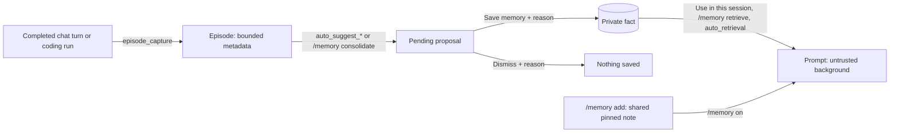

# Memory: save, suggest, review and retrieve

[STRUCTURED_MEMORY.md](STRUCTURED_MEMORY.md) defines gates, ownership, storage,
limits and automatic behavior; the command table is
[CONSOLE.md §7.8](CONSOLE.md#78-slash-command-quick-reference).

Memory has shared-home pinned notes and an account-private structured store,
without embeddings or vector search. The Harness proposes **summaries, durable
insights, or both** from completed chat turns and coding runs. **Only Save
memory with a reason saves a fact.** Recalled text is untrusted background
and cannot authorize tools, coding or network.

Fresh configuration enables pinned-note inclusion (`memory.enabled: true`) and
every structured-memory gate; upgrades keep existing config, `harness.json`
choices and administrator overrides.



## What counts as memory

Paths are relative to `CGAGENTHARNESS_HOME` (default `~/.CGagentHarness`).

| Kind | How it is saved / scope | How it is used later |
|---|---|---|
| Chat history | Successful exchanges in `sessions/*.json`; account-owned | Bounded recent messages from the selected session accompany later chat. Not a durable-fact extractor. |
| Pinned notes | `/memory add <literal text>` writes `memory/notes.json`; shared home | In the prompt while `/memory on`; see [Pinned notes](#pinned-notes). |
| Uploaded notes | `.md`/`.txt` files added under **Memory → Manage uploaded notes**; account-private | Matching passages reach local chat as untrusted excerpts ([Console](CONSOLE.md)). Not facts, not pins. |
| Persona / soul | `soul.md`; shared home; edit/save or reviewed `/soul apply <id> <reason>` | `/soul on\|off` controls prompt inclusion. |
| Structured facts | Private `memory/structured.sqlite3`; `/memory save`, governed fact HTTP writes, or approved proposals | List with `/memory facts`; select for explicit recall or use gated lexical (FTS5) facts-only retrieval. Saving alone does not put a fact in the prompt. |
| Pending proposals | Same private store; a model or operator may propose | Memory cards show suggested text, sources and revision. Pending text never enters chat. |
| Episodes | Private bounded metadata from captured chat or coding runs; optional human `semantic_summary` | Provenance and consolidation input. Never injected into chat or indexed. |

`session_summary` and `insight` are categories, not stores: a suggestion covers
one completed turn or run, and applying it creates a fact without filling the
episode's `semantic_summary`.

## Pinned notes

```text
/memory
/memory add Prefer metric units in examples.
/memory on
/prompt
```

- `/memory` shows inclusion state, note IDs, structured-memory gates and fact/proposal counts.
- `/memory add <note>` stores those exact words; it never summarizes sessions
  and does **not** turn inclusion on.
- `/memory on` includes saved notes in later chat, and only notes: it opens no
  structured-memory gate. `/memory off` keeps the notes and excludes them.
- `/memory forget <id>` deletes one note; `/memory clear` deletes all.
- Changes apply on the next chat request, for every session in this home.

`memory/notes.json` holds at most 20 notes, 500 characters per note and 3,000
characters of assembled prompt context, so the prompt may omit notes from a
full store. Empty, oversized and blocked instruction-override content is
rejected; these limits are constants, not YAML settings. If enabled notes are
absent from `/prompt`, inspect `/memory` for a store error and back up before
manual repair.

Chat can list notes included in its prompt but cannot save or delete them.

## Gates and configuration

Set keys under `structured_memory:` in `config.yaml`, then restart. Gates
require literal YAML `true`; quoted `"true"` and missing keys are off.
Administrators can change sub-gates live, such as `/memory auto-retrieve off`;
these overlays persist and override config but cannot open the store: only
`enabled: true` plus a restart creates and opens `memory/structured.sqlite3`.
`/memory` shows the effective gates; `GET /api/structured-memory` adds queue
status and `config_drift` (shipped-on keys your `config.yaml` omits, which
read as off). [The gate table](STRUCTURED_MEMORY.md#gates) lists every gate,
its overlay, its dependencies and what off guarantees.

### Enable in an existing home

Fresh homes ship these values. In an existing home, merge them into the
existing block without duplicating keys, then restart:

```yaml
structured_memory:
  enabled: true
  episode_capture: true
  auto_suggest_chat: true
  auto_suggest_coding: true
  suggestion_mode: "both" # "summaries", "insights", or "both"
  suggestion_supported: [{ model: "qwen3.8:27b-mlx-cg", modes: [summaries, insights, both] }]
  consolidation: true
  auto_consolidation: true
  explicit_recall: true
  retrieval: true
  auto_retrieval: true
```

Slash overrides take precedence over these keys; after a restart, run
`/memory capture on` and any other overlay this recipe needs. To go one gate
at a time, follow the [enable order](STRUCTURED_MEMORY.md#enable-order).

## Automatic suggestions and review

With store, capture and source enabled, completed work can produce pending
`session_summary`, `insight`, or both according to `suggestion_mode`, for local
models listed in `suggestion_supported` ([D7](STRUCTURED_MEMORY.md#completion-suggestions)).
The shipped chat default `qwen3.8:27b-mlx-cg` is listed; other models report
`unsupported_model_mode` until added. No setting approves proposals.

Open **Memory** or `/memory proposals`: cards show full text and affected
memories, and collapsed **Suggestion activity** holds source IDs, models,
counts and failures. Review content, action, sources and repository scope;
confidence is not proof. Enter a reason and choose **Save memory** or
**Dismiss**; blank reasons fail, and a stale revision needs a refresh.
Applied proposals appear under **Saved facts**.

The HTTP equivalent is POST `/api/structured-memory/proposals/{id}` with
`revision`, `confirm: true`, nonblank `reason` and `apply: true|false`, using
`X-CyClaw-CSRF`. Proposing needs no confirmation; direct fact writes do.

A gate, an injection check, a queue limit, a model or schema failure or full
proposal capacity can prevent a draft without failing the work; review
pending proposals to free capacity. Queued inputs are RAM-only: expiry, clear
or restart discards them with a receipt, and nothing is replayed.

## Save a fact manually

Keep `enabled: true`. Automatic generation and capture may stay off:

```text
/memory save For repository example, use metric units in examples. :: My reviewed standing preference
```

The command is the confirmation of a private fact write and requires a reason
after the last `::`. It uses category `manual` and needs an open store, but no
capture or model inference. Plain language such as "remember this" does not run
it; with suggestions enabled it may produce a draft, never an approval.
For manual-only facts, see [turn automation off](#turn-automation-or-the-store-off).

## Summarize and consolidate episodes

Capture stages metadata, not durable facts. After a successful captured turn,
write the one durable sentence you want considered, then consolidate it:

```text
/memory remember Prefer metric units in examples. :: My standing preference
/memory consolidation on
/memory consolidate <returned-episode-id> [episode-id...]
/memory proposals
```

`remember` attaches the bounded, scanned sentence to your latest completed
episode and prints its ID. It requires a reason and an open store, saves no
fact and starts no model run: it is **not chat autosave**.

`consolidate` sends only those episode summaries to the local model (no tools,
no web, no recalled facts) and writes pending proposals to review as above.
Summary-less episodes still run, with worse quality: metadata alone is not a
source of facts.

With `auto_consolidation` on, an idle worker may claim summarized episodes
([eligibility](STRUCTURED_MEMORY.md#consolidation)); it never preempts chat,
and later summary edits do not replay a completed batch.

## Retrieve and inspect

- `/memory facts` lists your facts even with prompt recall off.
- **Use in this session** (Memory tab) selects a fact's `public_id` and
  `expected_revision` for the open session; `selected_facts` on `/api/chat` or
  `/api/prompt/preview` selects per request. With `explicit_recall` on,
  assembly rechecks ownership, active state and revision.
- `/memory search <query>` (or `GET /api/structured-memory/search`) returns
  candidates only; it does **not** select or inject. Retrieval off is HTTP 409,
  not a silent empty inject.
- `/memory retrieve <query>` sends that query as a chat turn and force-includes
  rechecked matches for that request only.
- `/prompt` previews selected facts, pinned notes and persona; its
  `structured_facts.injected` / `dropped` is the set chat would send.

With `auto_retrieval` and `retrieval` on, chat matches any meaningful word in the
bounded prompt prefix, ranks candidates with FTS5/BM25, and injects rechecked
top-k facts without a per-request flag. Common question words are ignored;
explicit keyword queries remain all-terms matches. Retrieval is lexical, so
synonyms may not match. `/memory auto-retrieve off` leaves only explicit picks.

Owner, active status, revision and [prompt-budget](STRUCTURED_MEMORY.md#prompt-budget)
checks still apply, so a saved fact can exist without appearing in a
particular prompt. Pending proposals and episode summaries never enter it.

## Turn automation or the store off

To keep manual facts but stop automation, leave the store enabled and turn the
capture and suggestion gates off (`/memory capture off`, `/memory
auto-suggest-chat off`, `/memory auto-suggest-coding off`, `/memory
auto-consolidate off`, or config `false` plus restart); facts and proposals
remain. `enabled: false` stops opening the database without deleting it or
disabling pinned notes, persona or sessions.

`/clear` clears the display. Sessions Clear cancels waiting/in-flight chat
suggestions, deletes your uploaded notes (saying so when some could not be
removed) and keeps facts and proposals; derived episodes stay unless you also
confirm `delete_derived_episodes`. Export and purge:
[rollback](STRUCTURED_MEMORY.md#rollback).
