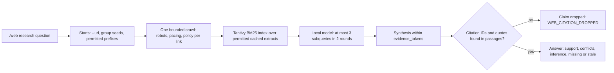

# Accounts, HTTPS and permitted web research

Fresh homes enable HTTPS, role authentication and web operations. Web content
needs an explicit URL grant; the allowlist starts with one seeded rule,
`https://www.google.com/*`, for public Google search.
Upgrades preserve `config.yaml`; missing legacy auth or TLS switches remain off.
To adopt the defaults, merge these literal values and restart the server:

```yaml
auth:
  enabled: true
tls:
  enabled: true
  auto_generate: true
  certificate_days: 365
  cert_file: ""
  key_file: ""
security:
  api_key_optional: true
```

Malformed auth/TLS booleans refuse configuration. The old
`security.api_key_optional: false` mode is ignored, and a harness key neither
blocks a valid account nor grants access.

## Accounts and roles

### First login and passwords

A fresh store's `admin` password is a random one-time code in owner-only
`<home>/setup-code`, deleted once replaced; other local accounts cannot claim
it. Homes still on `admin` / `admin` rotate at startup. Sign in and replace it
with at least 12 characters; until then the account can only inspect its
identity, change its password or log out. Replacement checks the current
password and CSRF token, then invalidates old sessions.

Every role can **change password** with its current password. An
administrator uses **USERS** (`/users`) to create users or reset passwords.
Password reset, role change, disable and deletion revoke that account's
sessions. The last enabled administrator cannot be deleted, disabled or
demoted.

Console authentication probes time out after five seconds and account
mutations after fifteen, body included. A timeout does not prove a submitted
change was rejected; refresh before retrying.

### Roles

| Role | Allowed | Refused |
|---|---|---|
| Administrator (`admin`) | Normal harness work; users, roles, disable/reset; global credentials; web enablement and URL policy | Every operation lacking existing repository/write/approval/publication authorization |
| Portal operator (`operator`) | Chat; enabled permitted fetch/search/research; own sessions/jobs/schedules, shared notes/persona and authorized coding workflows; own password/logout | Users/roles, global keys, web enablement/allowlist changes, provider security configuration |
| Auditor (`audit`) | Minimal status, designated redacted `/api/audit`, own password/logout | Chat/research/jobs, shared operational data, keys, user administration, other mutations |
| Portal auditor (`portal_auditor`) | Local chat in own sessions, prompt preview, `/api/audit`, `/diag` when enabled | Memory, attachments, web tools, cloud, loops, model choice, deletion, keys, administration |

The account bar shows the signed-in role; an Auditor gets a permission refusal
in **Sessions** and a minimal read-only `/status`. Audit request records name
the actor and matched route, never passwords, session tokens, query bodies or
keys.

### API Keys

The **API Keys** tab lists `env_keys::MANAGED_KEYS`, except the harness and
planner keys, which `/api` manages; [supported managed
keys](INSTALL.md#supported-managed-keys) explains saved/active masks, restarts
and environment precedence. Administrators save, replace or clear values;
responses contain only masks and status. Save and clear use the OS credential
store and fail closed when it is unavailable, unless literal
`security.allow_plaintext_key_file: true` keeps the
[private legacy file](INSTALL.md#8-persistence-optional-keys-and-recovery).
A missing provider credential affects only that provider. Leave `GH_TOKEN`
unset to use existing `gh auth login`. Completion webhook bearers are
configured separately
([webhook guide](SPEND_AND_NOTIFICATIONS.md#configure-a-completion-webhook)).

### Account storage and recovery

Versioned `auth.sqlite3` stores accounts and hashed session tokens
transactionally. Private `auth.initialized` prevents a missing database
from becoming a fresh default-password bootstrap. A valid legacy `auth.json`
migrates once (`auth.json.pre-sqlite` keeps the private recovery copy; legacy
sessions log in again). Corrupt, empty, unsafe or unsupported initialized
stores refuse startup; nothing resets automatically. Stop the server before a
backup or recovery, keep the database and marker together, and do not delete
them to recreate `admin`.

Each scrypt derivation uses about 128 MiB, so `auth.max_concurrent_operations`
(default 1, range 1–4) bounds login and password work; extra attempts wait.
Sessions expire after `auth.session.idle_timeout_sec` (default 43200) without
use and `auth.session.absolute_timeout_sec` (default 604800) regardless, each
at most 30 days. Chat session files under `sessions/` are written atomically
with mode 0600 because history can carry pasted secrets;
`memory/structured.sqlite3` follows the same owner-only policy
([at-rest contract](STRUCTURED_MEMORY.md#threat-model-at-rest)).

### Session ownership and legacy adoption

New sessions carry the account's random `user_id`; listing, loading, search,
export, chat, prompt preview, goals, skills and style enforce that owner.
Administrators do not inherit other accounts' sessions. Auth-disabled
homes use owner `local`; enabling auth does not reassign that data.

Sessions without an owner are unassigned legacy data: kept on disk, hidden
from ordinary reads/search/export, and untouched by **Clear my session
history**. In **Sessions**, an administrator can open **Review unassigned legacy
sessions (admin)**, enter a reason, confirm authorization and choose **Adopt
into my account**. Adoption preserves the transcript and old blob
pin owners but clears the prior goal-stage coding approval, so coding work must
be staged and reviewed again. Unknown-schema, unreadable and interrupted staged
files remain for manual recovery.

Detached job and schedule management uses the same owner boundary
([contract](../INVARIANTS.md#session-export-and-transcript-search-stay-on-the-machine));
schedule dispatch rechecks the current account, so revocation stops later
occurrences.

## HTTPS and native trust

`serve` and the desktop sidecar share one transport setup. Generated material
is a unique P-256 key and certificate in private `tls/server.pem` (0600,
directory 0700) with SANs for `localhost`, `127.0.0.1` and `::1`, reused across
restarts and checked for name, validity and key consistency. Invalid or expired
material refuses startup; there is no HTTP fallback. Explicit
`tls.enabled: false` is the legacy HTTP choice. The loopback listener accepts
TLS 1.3 only.

The desktop app pins that exact leaf for its own WKWebView and changes no global
trust ([native trust](DESKTOP.md#ownership-ports-and-security-boundaries)).
The server checks origin, HTTP/2 `:authority` and HTTP/1 Host. HTTPS cookies
are Secure, HttpOnly and SameSite=Strict. Browsers do not isolate cookies by
port, and an IP address is one site, so any other service on the same loopback
address receives the session cookie when the browser visits it; on a shared
host, another account's loopback server could replay it.

Print the public certificate, or renew generated material:

```bash
./target/release/cgagentharness tls certificate > local-public.pem
# Stop this home's desktop/serve process before renewal:
./target/release/cgagentharness tls renew
```

Renewal preserves operator-supplied paths. For an operator certificate, set
both `tls.cert_file` and `tls.key_file` to absolute or home-relative paths,
with a valid chain, key and loopback SANs; the operator renews it.
Certificate-bound CLI sessions log in again after a renewal.

Browsers, including private windows, need separate trust. Native **Setup → Export
public browser certificate** saves the owned leaf and shows its SHA-256.
Safari and Chrome/Chromium on macOS use operator-managed Keychain SSL trust;
Firefox may need its own exception or a browser-trusted operator certificate.
Review trust again after a renewal, and never disable validation.

## Terminal access

`account` and `web` use the running home's authenticated API; no offline policy
mutation exists. Set absolute `CGAGENTHARNESS_HOME` when needed. Pass a desktop
or custom-port origin with `--url` after `account` or `web`.

```bash
./target/release/cgagentharness account --url https://127.0.0.1:8790 login admin
./target/release/cgagentharness account --url https://127.0.0.1:8790 password
./target/release/cgagentharness web status
./target/release/cgagentharness web allow 'https://example.com/docs/*' --group docs --seed https://example.com/docs/
./target/release/cgagentharness web fetch https://example.com/docs/start
./target/release/cgagentharness web search 'veeam software cve' --count 5
./target/release/cgagentharness web research 'How does widget_open fail?' --group docs
./target/release/cgagentharness web deny 'https://example.com/docs/*'
./target/release/cgagentharness account logout
```

Passwords are read from hidden terminal input (automation may supply stdin;
Windows needs a private stdin pipe); never put secrets in argv or chat. Private
`cli-session.json` binds the cookie to the origin and certificate; logout
removes it. The CLI refuses foreign origins, redirects, proxies and certificate
substitution before sending credentials.

## Web permissions

Web settings persist; absent/invalid legacy `web_enabled` stays off.
`/web on|off` (also terminal `web on|off`) controls future reads and injection.
Enablement and policy are **shared-home**; selections are account-private.
Allowlist mode is the default and requires URL grants. An administrator can
confirm `/web mode denylist` to permit unblocked public URLs. `/web block` and
`/web unblock` manage blocks, which win in both modes and across HTTP/HTTPS; a
host without a path blocks its subdomains too. Switching modes preserves both
lists, and named groups still restrict reads to their allow rules.
`/web status` shows policy; `/web check URL` checks permission without networking.

`tools/web_allowlist.json` is the v1 policy: up to `web.max_rules` entries per
allow/block list (default 64, range 1–256, restart-only; batches name 1–32),
capped at `max(64 KiB, web.max_rules × 4 KiB)`. A policy over a lowered cap is
refused whole. `allow` validates groups and seeds, assigns stable IDs and
writes batches atomically. A missing policy refuses reads until an authorized
mutation initializes it; invalid or unreadable files never reset. Stop the
server before manual edits.

| Rule | Meaning |
|---|---|
| `https://example.com/article` | That canonical URL only, no children or additional query |
| `https://example.com/docs/*` | `/docs/` and descendants, excluding `/docs` |
| `https://example.com/*` | Paths and query strings on that exact HTTPS origin, including `/` |
| `https://*.example.com/docs/*` | Explicit subdomains below the named domain; apex excluded |
| `https://*.example.com` | Each subdomain's `/` only; add `/*` for paths |
| `https://example.com/article?q=one` | Exact query identity/order; no arbitrary parameters |

Console `/web` adds only `https://` to scheme-less operands. Default ports,
IDNA and hostname case normalize; schemes never downgrade; fragments are
stripped. Trailing-dot hosts, credentials, alternate IP spellings, dot
segments, encoded path separators/dots/nested escapes, malformed escapes,
encoded controls and ambiguous authorities are refused. Encoded
punctuation/space in query data keeps its identity and cannot change the
parsed host or path. Path wildcards include query strings, but never suffix
impostors or alternate ports. `www.example.org` and `example.org` are distinct.
Discovered links still require current permission.

HTML extraction shares the request deadline and stops on cancellation.
`web.html_parser_handles` (seeded 4096, 512 if absent, range 64–4096,
restart-only) bounds parser state; excessive nesting returns
`WEB_HTML_COMPLEXITY` without saving partial evidence.

Each rule belongs to one source group, `default` unless `--group NAME` names
another. Repeatable `--seed URL` records starting pages; each seed must fit a
pattern in the same grant. `--group` on `check`, `fetch`, `pages`, `search`
or `research` limits that request to the group's allow rules. `/web deny` removes
an allow rule ID or matching pattern across groups; it does not add a block.

Legacy rows migrate as exact URLs (add a wildcard to permit discovery); one
invalid row fails the whole migration. Legacy `web_context.txt`/`web_last.json`
are never injected; selections live in
`tools/web_<account-hash>_{last,context}.json`.

## Search, fetch and research

[Google search](#google-search) covers listing permissions. In default
allowlist mode, an administrator first grants the example page:

```text
/web allow https://doc.rust-lang.org/book/ch01-01-installation.html
```

Now ask in ordinary chat:

```text
Search Google for the top 5 results for "veeam software cve".
Read https://doc.rust-lang.org/book/ch01-01-installation.html and tell me which command checks the installed Rust compiler version.
```

Direct commands:

```text
/web search --count 3 veeam software cve
/web fetch https://doc.rust-lang.org/book/ch01-01-installation.html
/web allow https://www.veeam.com/* https://example.org/* --group vendors
/web check https://www.veeam.com/ https://example.org/ --group vendors
/web research --group vendors Compare the backup approaches
/web research --url https://www.veeam.com/ Summarize products and permitted internal links
/web pages --group vendors backup retention
```

Double-quoted phrases stay exact. Put `--` before query text that resembles
flags (`/web search -- --help`), or single-quote it
([slash reference](CONSOLE.md#78-slash-command-quick-reference)).

### Chat web tools

Local chat and `/loop` offer only `web_search` (configured-provider listings)
and `web_fetch` (an exact permitted URL); listings grant no page access. No
repository, shell, policy, account, key or mutation tool is exposed. Batches
validate before sequential reads; `web.chat_tool_calls` bounds all rounds
(1–30, default 30).

Tool-offering hops write up to the chat ceiling at temperature 0; tool-free
calls use `temperature`. Each call fits prompt, definitions, one reply and
minimal results inside `web.total_tokens`; a batch without room runs no reads,
and results shrink to the remaining calibrated room. `WEB_TOKEN_BUDGET`
reports refusal; `WEB_TOOLS_WITHHELD` reserves an answer after evidence.
A failed read returns its own `ok: false` outcome. A batch that fails entirely,
including a turn's first, ends the tool rounds: the model is asked once more
without tools and answers from what it has, and the fixed "Web operation
failed: CODE" line appears only when that answer is empty. Usage includes
completed model calls; missing upstream counts remain unknown. Cancellation
aborts the whole turn.

`web_fetch` selects up to three BM25 passages from the page it read, using
`query` (1–200 characters); lookups that rank several pages keep at most two
per page. Only whole delivered passages get receipt IDs and offsets. Omitted `refresh`
reuses fresh evidence already read for this goal; other reads default fresh.
`refresh:false` allows permitted cache within `web.stale_seconds`; `true` forces
a fresh read, including current facts.

Before choosing further tools, new useful passages receive a bounded digest
(≤1,024 output tokens) whose quotes and source IDs are validated; that proves
provenance, not logical support, and the final answer remains unvalidated.
Server-managed goal runs retain at most nine URL/hash receipts, three passage
IDs per URL and sixteen queries, plus the digest. Reuse rechecks age, hashes
and permissions. References survive compaction, not completion, cancellation
or restart.

`POST /api/chat` returns `web_tools`, reply and aggregate usage; the console
shows listings, selected passages, cache reuse, extraction path and digest
outcomes separately. Session `web_sources` is a bounded metadata ledger,
never a second page store. `web.carry_forward_sources` ships off; when
enabled it supplies permitted earlier URLs/queries, not page text.
Design and measurements: [router](WEB_DECISION_ROUTER.md); one-page version:
[README](../README.md#how-the-research-loop-decides).

### Google search

In **API Keys**, paste a [SerpAPI](https://serpapi.com/search-api) key (not a
Google Cloud key) into **Google results (SerpAPI)** or a Tavily key into
**Tavily search**, save, then **Test search**. Saving or clearing applies to
the next search; an inherited environment value still wins
([managed keys](INSTALL.md#supported-managed-keys)).

Restart-only `web.search.provider` is `auto`, `google-public`, `serpapi` or
`tavily`. `auto` follows the active keys: Tavily first, then SerpAPI, then
public Google. Keyed providers receive the keyword query, result count and
their own key, never chat history or account credentials. Keys never appear in
user-facing URLs, model context, returned metadata or errors; listings
reflecting a key are refused. With web enabled, keyed listings need no Google
URL grant.

- **SerpAPI** uses the fixed `https://serpapi.com/search.json` Google backend,
  key in the request query.
- **Tavily** sends one basic-depth request (one credit) to the fixed
  `https://api.tavily.com/search`, key in the Authorization header. Listings
  keep title, URL, snippet and bounded provider metadata, never a provider
  answer or page body. HTTP 429, 432 and 433 are quota refusals.
- **Public Google**, with no active key, requests the permitted search URL and
  parses organic result links in order. It never runs JavaScript, solves
  CAPTCHA, adopts cookies or invents results; challenges, redirects and
  transport failures are explicit.

Fresh homes seed the Google grant; a home that removed it re-grants it:

```text
/web allow https://www.google.com/*
/web search veeam software cve
```

`web.search.fallback_to_public_google` (ships true) and the opt-in
`fallback_to_serpapi` (after Tavily) try the next hop only when a provider is
unusable or its quota is spent; a rejected key, a refused query and a clean
zero-result answer never fall through. The answer carries `fallback_from`, each
hop logs `web_search_fallback`, and more than `fallback_alert_per_hour` (ships
20) SerpAPI fallbacks in a clock hour add one `web_search_fallback_burst` audit
line. The removed `provider: searxng` or a non-empty `web.search.searxng_url`
fails boot by name.

An exact generated search URL also works as a grant; an exact homepage grant
does not. `https://google.com/*` does not grant `www`, and redirects remain
refused. In allowlist mode, an empty policy gives `WEB_ALLOWLIST_EMPTY` and a
non-Google policy gives `WEB_GOOGLE_PERMISSION`. Denylist mode needs no Google
grant, but blocked Google URLs remain refused.

A challenge or block pauses public Google for `web.search_cooldown_public_sec`
(ships 600); a quota refusal pauses SerpAPI or Tavily for
`web.search_cooldown_quota_sec` (0: next clock hour). A paused search answers
`WEB_SEARCH_COOLDOWN` ("cooling down until HH:MM", local time) without a
request; `/loop` does not count it. Restart clears it; rejected keys never pause.

`/web search` defaults to Google in the console and CLI; `/web pages`, or a
source-group argument, selects the permitted-page passage search. For API
compatibility, `POST /api/web/search` without `engine` still means page search;
send `engine: "google"` and optional `count` (1–10, default 5) for listings.
`/api/web/research` accepts only the page-search engine.

### Fetch, discovery and research

Fetch accepts exact URLs only; wildcard patterns belong in `allow`.
A `fetch` batch validates all targets before any request and shares page, byte,
time and per-site limits. Partial reads report coverage and failures.

Every content request is DNS-pinned to checked public addresses with TLS hostname
validation and no reuse, retries, proxies, redirects, compression or cookies
([contract](../INVARIANTS.md#public-web-evidence-requires-current-content-permission)).

Opt-in `web.firecrawl.enabled` (ships off; needs **Firecrawl page reader** in API
Keys) is the one exception, for exact reads only: `fetch`, chat `web_fetch` and
batches, never discovery, crawl or search. When the pinned read gets a 403,
429 or 503, or a script shell (scripted HTML whose text is under 200
characters and under 5% of the markup), the authorized URL leaves the machine
once, to the fixed `https://api.firecrawl.dev/v2/scrape`: basic proxy,
markdown only, `storeInCache: false`. An answer naming another final URL is
refused as a redirect, and no links are kept. The page carries
`via: firecrawl`. `web.firecrawl.max_per_hour` (default 20) caps reads, and
batches charge both reads to `web.run_bytes`; HTTP 402 or 429 pauses Firecrawl
like a search quota. A failed fallback keeps the original result, with its
code in `details.fallback`.

The HTML parser drops executable, hidden and navigation content. Extracts keep
canonical URLs, hashes, fetch age, validators, extraction version and passage
offsets.

The shipped YAML lists every `web.*` limit with its range; a home missing
those keys gets smaller code defaults.
[Reloadable limits](INSTALL.md#reload-limits-without-a-restart) names the ones
that change without a restart. Failed requests can charge the full response
allowance.

For `research`, repeat `--url` for permitted starts; starts narrow one run but
grant nothing. Otherwise traversal uses group seeds and permitted literal prefixes
such as `/docs/`. A host wildcard without seeds can use up to four matching,
currently permitted cached pages; without either, it reports `WEB_SEED_REQUIRED`.
Origin `/robots.txt` is readable when an allow rule covers that origin, even if
path-restricted, or in ungrouped denylist mode; blocks still win. Unreadable
robots leaves seeds readable but stops link traversal; robots consumes requests
but supplies no evidence. Links are deduplicated, paced and policy-checked.
There is no sitemap discovery, provider key or cloud fallback.

Tantivy rebuilds a bounded in-memory BM25 index from permitted cached extracts,
with exact phrase and identifier matching (`a_b`, `a::b`), title and heading
boosts, and deduplication. Derived cache corruption grants nothing.
Validators reduce bytes, not requests.



Shipped budgets are 1200s for discovery including cold load, then 1800s
answering (300s each if the keys are absent); cancellation includes loading.
Token budgets and smaller windows:
[MODELS.md](MODELS.md#4-select-an-installed-model-and-check-ollama). Provider
usage wins; otherwise bytes/4 plus overhead is estimated. Synthesis drops
unfitting low-ranked passages (`WEB_EVIDENCE_TRIMMED`). Retrieval interleaves
the question and subqueries without embeddings or reranking. Console research
(`/web job`, `/web jobs`) outlives the tab; `/web cancel` stops it.

Citation IDs and quotes are checked against passages, but semantic support still
needs judgment. Rank is not truth, and fetch age is not publication date.

### Saved web selection

`/web inject` selects the last fetched or page-search extract, or the first
successful batch page, for local chat, as a bounded excerpt, not a summary.
`/prompt` previews it; `/web forget` clears it without altering old chats.
Google listings never enter the page cache or selection, and `/web research`
does not replace the selection, although its fetched pages reuse the cache.

## Security boundaries

When auth is enabled, all operational API reads and writes require an account.
Public endpoints are static login assets, minimal status, setup status and login.
Mutation CSRF remains `X-CyClaw-CSRF`. Forwarding headers are refused, and
reverse proxies are unsupported. The dedicated
[machine gateway](MCP.md#private-read-only-memory-gateway) does not inherit console authority.

Ownership follows [session ownership](#session-ownership-and-legacy-adoption)
and the shared-resource list in [SECURITY.md](../SECURITY.md#local-authority-and-shared-resources).
Research questions, answers, controller state and web selections belong to the
initiating random account identity, so a recreated username inherits nothing;
a deleted account's selections can remain on disk, inaccessible.

Search listings grant nothing: every follow-up read independently passes
current policy, account and public-address checks. Policy is rechecked at
dispatch, cache/index/context reads, storage, model use and delivery;
revocation discards in-flight evidence and blocks revoked cache, but cannot
erase earlier conversation text or model requests
([contract](../INVARIANTS.md#public-web-evidence-requires-current-content-permission)).
URL policy covers only web, not OS, model or GitHub connections.

## Reproducible evidence

`tests/chat_web.rs`, `tests/web_research.rs`, `tests/web_phase2_redteam.rs` and
`tests/auth_guards.rs` pin the contracts above.

```bash
cargo run --locked --example web_research_benchmark -- /absolute/report.json
cargo run --locked --example web_research_benchmark -- /absolute/live-report.json --live
```

The fixed corpus mixes identifiers, paraphrases, stale and contradictory claims,
no-answer cases and hostile text; `--live` uses an installed local model and
downloads nothing.
