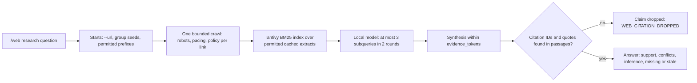

# Accounts, HTTPS and permitted web research

Fresh homes enable HTTPS, role authentication, and web operations. Web content
needs an explicit URL grant; the allowlist starts with one seeded rule,
`https://www.google.com/*`, for public Google search.
Upgrades preserve `config.yaml`; missing legacy auth or TLS switches remain off.
To adopt the defaults, merge these literal booleans into the active mappings,
then restart the server:

```yaml
auth:
  enabled: true
tls:
  enabled: true
  auto_generate: true
  certificate_days: 365
  cert_file: ""
  key_file: ""
security:
  api_key_optional: true
```

Malformed auth/TLS booleans refuse configuration. The old
`security.api_key_optional: false` mode is ignored, and a harness key neither
blocks a valid account nor grants access.

## Accounts and roles

### First login and passwords

A fresh store's `admin` password is a random one-time code in owner-only
`<home>/setup-code`, deleted once replaced; other local accounts cannot claim
it. Homes still on `admin` / `admin` rotate at startup. Sign in and replace it with at
least 12 characters. Until then, the account can inspect its identity, change
its password, or log out, but cannot use chat, research, coding, administration,
or keys. Replacement checks the current password and CSRF token, then invalidates
old sessions. Administrative resets retain the ordinary password policy.

Every role can use **change password** with its current password. An administrator
uses **USERS** (`/users`) to create users or reset passwords. Password reset,
role change, disable, and deletion revoke that account's sessions. The last
enabled administrator cannot be deleted, disabled, or demoted. **logout** revokes
the session and clears private displayed state.

Console authentication probes time out after five seconds and account
mutations after fifteen, body included. A timeout does not prove a submitted
change was rejected; refresh before retrying.

### Roles

| Role | Allowed | Refused |
|---|---|---|
| Administrator (`admin`) | Normal harness work; users, roles, disable/reset; global credentials; web enablement and URL policy | Every operation lacking existing repository/write/approval/publication authorization |
| Portal operator (`operator`) | Chat; enabled permitted fetch/search/research; own sessions/jobs/schedules, shared notes/persona and authorized coding workflows; own password/logout | Users/roles, global keys, web enablement/allowlist changes, provider security configuration |
| Auditor (`audit`) | Minimal status, designated redacted `/api/audit`, own password/logout | Chat/research/jobs, shared operational data, keys, user administration, other mutations |
| Portal auditor (`portal_auditor`) | Local chat in own sessions, prompt preview, `/api/audit`, `/diag` when enabled | Memory, attachments, web tools, cloud, loops, model choice, deletion, keys, administration |

The account bar displays the signed-in role; an Auditor sees a permission refusal
in **Sessions** and a minimal read-only `/status`. Audit request records identify the actor and
matched route, without passwords, session tokens, query bodies, or keys; the
auditor projection exposes only those redacted fields.

### API Keys

The left tab is **API Keys**. Its rows come from `env_keys::MANAGED_KEYS`,
except the harness and planner keys, which `/api` manages; [supported managed
keys](INSTALL.md#supported-managed-keys) lists them and explains saved/active
masks, restarts and environment precedence. Administrators can
paste/save/replace/clear saved values. GET/POST responses contain only masks and
status. Save and clear use the OS credential store and fail closed when it is
unavailable. Literal `security.allow_plaintext_key_file: true` keeps the
[private legacy file](INSTALL.md#8-persistence-optional-keys-and-recovery). Values are never stored in SQLite. Missing provider credentials affect only the selected provider's
operation. Leave `GH_TOKEN` unset to use existing `gh auth login`. Completion
webhook bearers are configured separately; see the
[webhook guide](SPEND_AND_NOTIFICATIONS.md#configure-a-completion-webhook).

### Account storage and recovery

Versioned `auth.sqlite3` stores accounts and hashed session tokens with
transactional updates. Private `auth.initialized` prevents a missing database
from becoming a fresh default-password bootstrap.
A valid legacy `auth.json` migrates its user hashes, roles, disabled state,
lockouts, and timestamps; `auth.json.pre-sqlite` preserves the exact private
recovery copy. Legacy sessions require a new login. The original JSON remains a
recovery artifact, not the live store. A legacy pending-password `admin` signs
in with a one-time setup code. Corrupt, empty, unsafe, or unsupported initialized stores
refuse startup; no automatic reset occurs. Failed writes do not publish successful
in-memory account changes. Stop the server before an operator-controlled backup
or recovery; preserve the database and initialization marker together, and do
not delete them to recreate `admin`.

Each scrypt derivation uses about 128 MiB. `auth.max_concurrent_operations`
(default 1, range 1–4) bounds login and password work; extra attempts wait.
Sessions expire after `auth.session.idle_timeout_sec` (default 43200) without
use and `auth.session.absolute_timeout_sec` (default 604800) regardless, each at most 30 days. Chat
session files under `sessions/` are written atomically with mode 0600 because
history can carry pasted secrets.

Structured memory's `memory/structured.sqlite3` uses the same owner-only open
policy and refuses corrupt or uninitialized files rather than bootstrapping
([at-rest contract](STRUCTURED_MEMORY.md#threat-model-at-rest)).

### Session ownership and legacy adoption

New sessions use schema version 1 and the account's random `user_id`. Listing,
loading, search, export, chat, prompt preview, goals, skills, and style enforce
that owner. Administrators do not inherit other accounts' sessions. Auth-disabled
homes use owner `local`; enabling auth does not reassign that data.

Sessions without an owner are unassigned legacy shared data. They remain on disk,
are hidden from ordinary reads/search/export, and survive **Clear my session
history**. In **Sessions**, an administrator can choose **Review unassigned legacy
sessions (admin)**, inspect metadata, enter a reason, confirm authorization and
choose **Adopt into my account**. Adoption preserves the transcript and old blob
pin owners but clears the prior goal-stage coding approval. The administrator
must stage and review coding work again. There is no implicit sharing or account
reassignment. Unknown-schema, unreadable and interrupted staged files remain for
manual recovery; clearing history cannot invent their owner.

Detached job and schedule management uses the same owner boundary
([contract](../INVARIANTS.md#session-export-and-transcript-search-stay-on-the-machine));
schedule dispatch rechecks the current account, so revocation stops later
occurrences.

## HTTPS and native trust

Both `serve` and the desktop sidecar use the same transport setup. Fresh generated
material is a unique P-256 key and certificate, persisted together atomically as
private `tls/server.pem` (0600, directory 0700). SANs cover `localhost`,
`127.0.0.1`, and `::1`. The material is reused across restarts and checked for
name, time validity and key consistency. Invalid/expired material refuses startup;
there is no HTTP fallback. Explicit `tls.enabled: false` is the legacy HTTP choice.
The loopback HTTPS listener accepts TLS 1.3 only. Outbound public-web clients retain their existing verified TLS compatibility.

The desktop receives certificate DER and fingerprint through its owned sidecar's
challenge and PID handshake. Readiness verifies that leaf before HTTP. WKWebView
uses it as the sole connection anchor with hostname, time and trust checks.
The server checks origin, HTTP/2 `:authority` and HTTP/1 Host, taking the scheme
from trusted listener metadata. The app changes no global trust. HTTPS
cookies are Secure, HttpOnly, and SameSite=Strict; logout uses the same attributes.
Browsers do not isolate cookies by port, and an IP address is one site, so any
other service on the same loopback address receives the session cookie when the
browser visits it. On a shared host, another account's loopback server could
replay it.
Public fetch uses public trust, and the model URL remains separate.

Print only the public certificate, or explicitly renew generated material:

```bash
./target/release/cgagentharness tls certificate > local-public.pem
# Stop this home's desktop/serve process before renewal:
./target/release/cgagentharness tls renew
```

Renewal acquires home ownership and preserves operator-supplied paths. For an
operator certificate, set both `tls.cert_file` and `tls.key_file` to absolute or
home-relative paths, with a valid chain, key, and loopback SANs. The operator
renews it. Old certificate-bound CLI sessions must log in again.

Browsers, including private windows, need separate trust. Native **Setup → Export
public browser certificate** saves the owned leaf and displays its SHA-256.
Safari and Chrome/Chromium on macOS use operator-managed Keychain SSL trust;
Firefox may need its own exception or a browser-trusted operator certificate.
Renewal needs another review. The app installs no trust. Never disable validation.

## Terminal access

`account` and `web` use the running home's authenticated API; no offline policy
mutation exists. Set absolute `CGAGENTHARNESS_HOME` when needed. Pass a desktop
or custom-port origin with `--url` after `account` or `web`.

```bash
./target/release/cgagentharness account --url https://127.0.0.1:8790 login admin
./target/release/cgagentharness account --url https://127.0.0.1:8790 password
./target/release/cgagentharness web status
./target/release/cgagentharness web allow 'https://example.com/docs/*' --group docs --seed https://example.com/docs/
./target/release/cgagentharness web fetch https://example.com/docs/start
./target/release/cgagentharness web search 'veeam software cve' --count 5
./target/release/cgagentharness web research 'How does widget_open fail?' --group docs
./target/release/cgagentharness web deny 'https://example.com/docs/*'
./target/release/cgagentharness account logout
```

Passwords are read from hidden terminal input (automation may supply stdin;
Windows needs a private stdin pipe); never put secrets in argv or chat. Private `cli-session.json` binds
the cookie to the origin and certificate; logout revokes and removes it. Before
sending credentials, the CLI refuses foreign origins, redirects, proxies, and
certificate substitution.

## Web permissions

Explicit web settings persist; absent/invalid legacy `web_enabled` stays off.
`/web on|off` (also terminal `web on|off`) controls future reads/injection;
enablement and policy are **shared-home**; selections are account-private.
Allowlist mode is the default and requires URL grants. An administrator can
confirm `/web mode denylist` to permit unblocked public URLs. `/web block` adds
blocks; `/web unblock` removes them. Blocks win in both modes, including across
HTTP/HTTPS; a host without a path blocks its subdomains too. Switching modes
preserves both lists. Named groups still restrict reads to their allow rules.
`/web status` shows policy; `/web check URL` checks permission without networking.

`tools/web_allowlist.json` is the v1 policy: up to `web.max_rules` entries per
allow/block list (default 64, range 1–256, restart-only; batches name 1–32).
File size is capped at `max(64 KiB, web.max_rules × 4 KiB)`.
A policy over a lowered cap is refused whole. `/web allow`
and terminal `web allow` validate groups/seeds and assign stable IDs. Batches
write atomically. Missing policy refuses reads; an authorized policy mutation
can initialize it. Invalid/unreadable files never reset.
Stop the server before manual edits; otherwise use serialized atomic API/CLI mutations.

| Rule | Meaning |
|---|---|
| `https://example.com/article` | That canonical URL only, no children or additional query |
| `https://example.com/docs/*` | `/docs/` and descendants, excluding `/docs` |
| `https://example.com/*` | Paths and query strings on that exact HTTPS origin, including `/` |
| `https://*.example.com/docs/*` | Explicit subdomains below the named domain; apex excluded |
| `https://*.example.com` | Each subdomain's `/` only; add `/*` for paths |
| `https://example.com/article?q=one` | Exact query identity/order; no arbitrary parameters |

Console `/web` adds only `https://` to scheme-less operands. Default ports normalize; schemes never downgrade. Fragments are stripped. IDNA
and hostname case normalize; trailing-dot hosts, credentials, alternate IP
spellings, dot segments, encoded path separators/dots/nested escapes, malformed escapes
and ambiguous authorities are refused. Encoded punctuation/space in query data
retains its identity; it cannot change the parsed host or path. Encoded controls
remain refused. Path wildcards include query strings, but never suffix impostors
or alternate ports. `www.example.org` and `example.org` are distinct; neither is
inferred from the other. Scheme-relative discovered links resolve against the
source and still require current permission.

HTML page/listing extraction shares the request deadline and stops cooperatively on cancellation.
`web.html_parser_handles` (seeded 4096, 512 if absent, range 64–4096, restart-only) bounds live
open-element and formatting state; excessive nesting returns `WEB_HTML_COMPLEXITY`
without saving partial evidence. Byte and link limits still apply.

Each rule belongs to one source group, `default` unless `--group NAME` names
another. Repeatable `--seed URL` records concrete starting pages; each seed must
fit a pattern in the same grant. `--group` on `check`, `fetch`, `pages`, `search`
or `research` limits that request to the group's allow rules. `/web deny` removes
an allow rule ID or matching pattern across groups; it does not add a block.

Legacy rows migrate as exact URLs (add a wildcard to permit discovery); invalid
rows fail the whole migration, and the next authorized mutation persists v1.
Legacy `web_context.txt`/`web_last.json` are never injected; selections live in
`tools/web_<account-hash>_{last,context}.json`.

## Search, fetch and research

Enter slash commands as plain text starting with `/`. See [Google search permissions](#google-search).
In default allowlist mode, an administrator first grants the example page:

```text
/web allow https://doc.rust-lang.org/book/ch01-01-installation.html
```

Now ask in ordinary chat:

```text
Search Google for the top 5 results for "veeam software cve".
Read https://doc.rust-lang.org/book/ch01-01-installation.html and tell me which command checks the installed Rust compiler version.
```

Direct commands:

```text
/web search --count 3 veeam software cve
/web fetch https://doc.rust-lang.org/book/ch01-01-installation.html
/web allow https://www.veeam.com/* https://example.org/* --group vendors
/web check https://www.veeam.com/ https://example.org/ --group vendors
/web research --group vendors Compare the backup approaches
/web research --url https://www.veeam.com/ Summarize products and permitted internal links
/web pages --group vendors backup retention
/web cancel
/web inject
/web forget
```

Double-quoted query phrases retain their exact-phrase meaning. Use `--` before
query text that resembles flags, such as `/web search -- --help`, or single-quote
that literal argument. Other flag rules are in the
[slash-command quick reference](CONSOLE.md#78-slash-command-quick-reference).

### Chat web tools

Local chat and `/loop` offer only `web_search` (configured-provider listings)
and `web_fetch` (an exact permitted URL). The model chooses supplied local context,
search, or reads; listings grant no page access. No repository, shell, policy,
account, key or mutation tool is exposed. Batches validate before sequential
reads; `web.chat_tool_calls` bounds all rounds (1–30, default 30).

Routing hops use `models.local_llm.tool_max_tokens` (default 512), temperature 0.
A truncated answer gets a tool-free synthesis at the chat ceiling. The full
stored goal governs whether outside evidence is requested after a notes read.
Each call fits prompt, definitions, one reply and minimal results inside
`web.total_tokens`; insufficient batch room runs no reads. Results shrink to
remaining calibrated room. `WEB_TOKEN_BUDGET` reports refusal;
`WEB_TOOLS_WITHHELD` reserves an answer after evidence. Failed reads return their
own outcomes; an all-failed batch ends discovery. Usage includes completed model
calls; missing upstream counts remain unknown. Cancellation aborts the whole turn.

`web_fetch` selects up to three BM25 passages with `query` (1–200 characters).
Only whole delivered passages get receipt IDs and offsets. Omitted `refresh`
reuses fresh evidence already read for this goal; other reads default fresh.
`refresh:false` allows permitted cache within `web.stale_seconds`; `true` forces
a fresh read, including current facts. Firecrawl remains opt-in.

Before choosing further tools, new useful passages receive a bounded digest
(≤1,024 output tokens). Quote/source validation separates supported claims,
conflicts, inferences and missing coverage; it does not prove logical entailment.
The final model answer remains unvalidated. Server-managed goal runs retain at
most nine URL/hash receipts, three passage IDs per URL and sixteen queries,
plus the digest. Reuse rechecks age, hashes and permissions; unchanged passages
need no new digest. Failed digests retain valid passages. Bounded passages accompany restored findings. Evidence messages name
the current harness turn; tool calls do not advance it. References survive
compaction, not completion, cancellation or restart.

`POST /api/chat` returns `web_tools`, reply and aggregate usage. The console shows
listing metadata, selected passages, cache reuse, extraction path and digest
outcomes separately. Session `web_sources` remains a bounded metadata ledger,
never a second page store. `web.carry_forward_sources` still ships off; when
enabled it supplies permitted earlier URLs/queries, not page text.

[Router design and measurements](WEB_DECISION_ROUTER.md)
record the provider matrix, context limits and remaining acceptance gaps; the
[README](../README.md#how-the-research-loop-decides) has the one-page version.

### Google search

In **API Keys**, paste a [SerpAPI](https://serpapi.com/search-api) key (not a
Google Cloud key) into **Google results (SerpAPI)** or a Tavily key into
**Tavily search**, save, then **Test search**. Both use the OS credential store
([managed keys](INSTALL.md#supported-managed-keys)); saving or clearing applies
to the next search, and an inherited environment value still wins.

An active nonempty SerpAPI key selects the fixed `https://serpapi.com/search.json`
Google backend, key in the request query. Keyed providers receive the keyword
query, result count and their own key, never chat history or account credentials.
Keys never appear in user-facing URLs, model context, returned metadata or errors;
listings reflecting a key are refused. The client keeps public DNS pinning, shared
concurrency, no proxy/redirect/retry/pooling, and finite header/body/time bounds.
With web enabled, keyed listings need no Google URL grant.

With no active key, the app requests the permitted public Google search URL and
parses recognizable organic result links in order. It never runs JavaScript,
solves CAPTCHA, adopts cookies or invents results; challenges, redirects,
unreadable output and transport failures are explicit. Fresh homes seed
the Google grant; a home that removed it re-grants it:

```text
/web allow https://www.google.com/*
/web search veeam software cve
```

`web.search.provider` is `auto` (above), `google-public`, `serpapi` or `tavily`.
Tavily needs its key and never changes `auto`. Each search is one basic-depth
request (one credit) to the fixed `https://api.tavily.com/search`, key in the
Authorization header; `include_answer`, `include_raw_content` and `include_images`
are pinned off; listings keep title, URL, snippet and bounded optional provider rank,
score, highlighted terms and date, never a provider answer or page body. HTTP 429,
432 and 433 are quota refusals.
SearXNG support was removed: `provider: searxng` or a non-empty `web.search.searxng_url`
fails boot by name. `web.search.fallback_to_public_google` (ships true) and the opt-in
`fallback_to_serpapi` (after Tavily) try the next hop only when a provider is unusable or its quota is spent;
the answer carries `fallback_from`, each hop logs `web_search_fallback`, and more
than `fallback_alert_per_hour` (ships 20) SerpAPI fallbacks in a clock hour add one
`web_search_fallback_burst` audit line.

The exact generated search URL also works; an exact homepage grant is not enough.
`https://google.com/*` does not grant `www`; the apex endpoint may redirect and
redirects remain refused. In allowlist mode, an empty policy gives
`WEB_ALLOWLIST_EMPTY` and a non-Google policy gives `WEB_GOOGLE_PERMISSION`.
Denylist mode needs no Google grant, but blocked Google URLs remain refused.

A challenge or block pauses public Google for `web.search_cooldown_public_sec`; a
quota refusal pauses SerpAPI or Tavily for `web.search_cooldown_quota_sec` (0: next clock hour).
Paused search answers `WEB_SEARCH_COOLDOWN` ("cooling down until HH:MM", local time)
without a request; `/loop` does not count it. Restart clears it; rejected keys never pause.

`/web search` defaults to Google in the console and CLI; `/web pages` selects the
existing permitted-page passage search, as does a source-group argument
(including the legacy `/web search group=docs ...` form). For API compatibility,
`POST /api/web/search` without `engine` still means page search; explicitly send
`engine: "google"` and optional `count` (1–10, default 5) for Google listings.
Dedicated `/api/web/research` only accepts the page-search engine.

### Fetch, discovery and research

Fetch accepts exact URLs only; wildcard patterns belong in `allow`, not `fetch`.
A `fetch` batch validates all targets before any request and shares page, byte,
time and per-site limits. Partial reads show coverage/failures rather than
claiming complete success.

Every content request is DNS-pinned to checked public addresses with TLS hostname
validation and no reuse, retries, proxies, redirects, compression or cookies
([contract](../INVARIANTS.md#public-web-evidence-requires-current-content-permission)).

Opt-in `web.firecrawl.enabled` (ships off; needs **Firecrawl page reader** in API
Keys) is the one exception, for exact reads only: `fetch`, chat `web_fetch` and
batches, never discovery, crawl or search. When the pinned read gets a server's
403, 429 or 503, a script shell (scripted HTML with under 200 characters of
text, under 5% of the markup), an oversized body or a PDF (10 pages at most), the authorized URL goes to Firecrawl's fixed `https://api.firecrawl.dev/v2/scrape`
once: basic proxy, markdown only, `storeInCache: false`. The answer must name the
requested URL as final (else refused as a redirect); no links are kept.
The page carries `via: firecrawl`. `web.firecrawl.max_per_hour`
(default 20) caps reads, and batches charge both reads to `web.run_bytes`; HTTP 402
or 429 pauses Firecrawl like a search quota. A
failed fallback keeps the original result, with its code in `details.fallback`.
The HTML parser removes executable/hidden/navigation content and retains headings,
paragraphs, tables, lists and code. Extracts keep canonical URLs, hashes, fetch
age, validators, extraction version and original passage offsets.

Seeded: 40 page requests, 8 MiB charged bytes, 180 seconds per crawl; 15 seconds
and 1 MiB per response; 4 concurrent fetches, 400 ms per-origin pacing, 10
requests per origin; 256 cached pages/16 MiB. A home missing these keys uses 20
pages, 60 seconds, 2 fetches, 250 ms and 128 pages. `web.*` fields in the shipped YAML
list validated bounds; [reloadable limits](INSTALL.md#reload-limits-without-a-restart) names the ones an
administrator can reload without a restart. Failed requests can conservatively
charge the full response allowance. Reports expose partial coverage, failures and
unvisited work.

For `research`, repeat `--url` for permitted starts. Starts narrow one run but
grant nothing. Otherwise traversal uses group seeds and permitted literal prefixes
such as `/docs/`. A host wildcard without seeds can use up to four matching,
currently permitted cached pages; without either, it reports `WEB_SEED_REQUIRED`.
Each run attempts bounded discovery. Literal origin `/robots.txt` is readable
when an allow rule covers that origin, even if path-restricted, or in ungrouped
denylist mode; blocks still win. Unreadable robots leaves seeds readable but
stops link traversal. Links are deduplicated, paced and policy-checked. Robots
consumes requests but supplies no evidence. Sitemap discovery is absent.
Page research needs no provider key and has no cloud fallback.

Tantivy rebuilds a bounded in-memory BM25 index from permitted cached extracts.
Phrases, identifiers (each `a_b`/`a::b` word matches exactly), title and
heading boosts improve ranking; diversity and
deduplication reduce repetition. Derived cache corruption grants nothing.
Conditional refresh repeats network checks. Validators reduce bytes, not requests.



Research asks the local model for at most 3 subqueries in 2 rounds, runs at most
one bounded crawl, and synthesizes about 6,000 evidence tokens. Defaults:
28,000 total model tokens, 1200s discovery including cold load, then 1800s answering (300s each if the keys are absent).
Preload residency covers both budgets, capped at one hour; cancellation includes
loading. Smaller windows: [MODELS.md](MODELS.md#4-select-an-installed-model-and-check-ollama). Provider
usage wins; otherwise bytes/4 plus overhead is estimated, charging incomplete
output conservatively. Synthesis drops unfitting low-ranked passages
(`WEB_EVIDENCE_TRIMMED`). Bounded JSON output has no commands or privileged tools.
Retrieval interleaves the question and subqueries without embeddings or reranking.
Console research (`/web job`, `/web jobs`) outlives the tab; `/web cancel`
stops it.

Citation IDs and quotes are checked against passages, but semantic support still
needs judgment. Rank is not truth, and fetch age is not publication date. Bounded
runs never claim completeness; no-answer results abstain and failures stay visible.

### Saved web selection

`/web inject` selects the last fetched or page-search extract, or the first
successful batch page, for local chat. It stores a bounded excerpt, not a summary.
`/prompt` previews it; `/web forget` clears selection without altering old chats.
Google listings never enter the page cache or selection. `/web research` is a
request-scoped multi-source synthesis and does not replace selection, although
its fetched pages reuse the cache.

## Security boundaries

When auth is enabled, all operational API reads and writes require an account.
Public endpoints are static login assets, minimal status, setup status, and login.
Mutation CSRF remains `X-CyClaw-CSRF`. Forwarding headers
are refused, and reverse proxies are unsupported. The dedicated
[machine gateway](MCP.md#private-read-only-memory-gateway) does not inherit console authority.

Ownership follows [session ownership](#session-ownership-and-legacy-adoption)
and the shared-resource list in [SECURITY.md](../SECURITY.md#local-authority-and-shared-resources).
Research questions, answers, controller state, and web selections belong to the
initiating random account identity, so a recreated username inherits nothing.
Deleted accounts can leave private selections on disk, inaccessible to replacements.

Chat `web_fetch` reaches URLs permitted by the active mode, bounded by
`web.chat_tool_calls`. Fresh homes permit only Google search; a home with no rules
left refuses page fetching with `WEB_ALLOWLIST_EMPTY`; confirmed denylist mode broadens public access.
Search listings grant nothing: follow-up reads independently pass current policy,
account and public-address checks.

Policy is rechecked at dispatch, cache/index/context reads, storage, model use,
and delivery; revocation discards in-flight evidence and blocks revoked cache,
but cannot erase earlier conversation text or model requests
([contract](../INVARIANTS.md#public-web-evidence-requires-current-content-permission)).
URL policy covers only web, not OS, model, or GitHub connections.

## Reproducible evidence

`tests/chat_web.rs`, `tests/web_research.rs`, `tests/web_phase2_redteam.rs` and
`tests/auth_guards.rs` pin the contracts above; WKWebView acceptance is separate evidence.

```bash
cargo run --locked --example web_research_benchmark -- /absolute/report.json
cargo run --locked --example web_research_benchmark -- /absolute/live-report.json --live
```

The fixed corpus mixes identifiers, paraphrases, stale and contradictory claims,
no-answer cases and hostile text; `--live` uses an installed local model.
Neither mode downloads a model or publishes.
